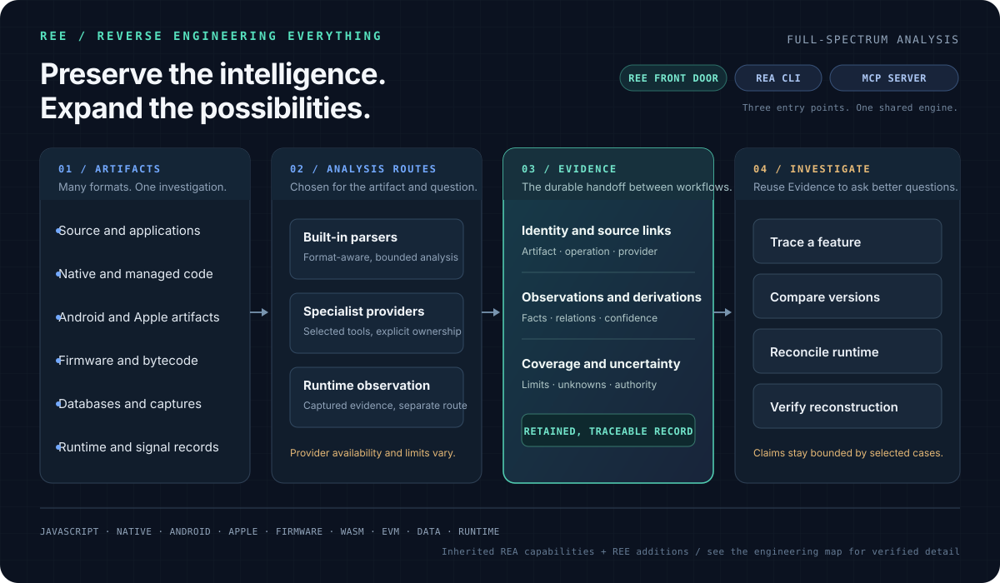

<div align="center">

# REE

### Preserve the intelligence. Expand the possibilities.

**Reverse Engineering Everything**

A local investigation workbench built on the full REA analysis engine: native and managed binaries, apps, Android, firmware, runtime observations, and more.

[Start here](#start-here) · [How the system fits together](#from-artifact-to-claim) · [Choose an investigation path](#choose-a-path) · [Explore the engine](#under-the-surface) · [Use with Codex](#connect-codex)

</div>

---

REE gives the REA analysis engine a deliberate front door and an evidence-centered workflow. **REE** is this project's identity, onboarding, and beginner CLI. **REA** is the inherited analysis engine and MCP server. The Mac-first entry point adds a more approachable way into the system; it does not narrow the engine's capabilities or replace its mature workflows. The repository preserves that foundation, its licensing, and its attribution while building on it.

The aim is disciplined understanding: identify the artifact, choose an analysis route that fits it, retain where each result came from, and keep conclusions within the evidence collected. No single provider or reconstruction check explains every system.



## Start here

On macOS, the quickest first look is a small, fictional lesson served on your machine. It needs no REA build and does not inspect another application. The underlying engine also has platform-specific Linux and Windows workflows.

```sh
node ree.mjs doctor
node ree.mjs lab --open
```

`doctor` reports host and toolchain readiness without installing software. The visual lesson explains a sample relationship graph; it is not a live analyzer dashboard.

On macOS, you can also open [`Start-REE.command`](Start-REE.command) from Finder. Keep its Terminal window open while the lesson runs; press Control+C to stop it. If macOS blocks the unsigned launcher, run `zsh ./Start-REE.command` from the checkout.

### Build REA and run the owned example

The checkout pins Node `24.18.0` in `.nvmrc` and npm `11.16.0` in `package.json`. With the pinned Node version already installed, use it and build the local analyzer:

```sh
nvm use
npm ci
npm run build:cached

OUT="$(mktemp -d)/ree-demo"
node ree.mjs demo --run --out "$OUT"
cat "$OUT/REE_EVIDENCE_REPORT.md"
```

This runs static analysis on REE's own source-controlled example. It saves the full `evidence.json` plus a selected view, summary, and readable report outside the checkout. The command uses the locally built REA engine; it does not analyze or launch a third-party target.

For a source tree or Electron ASAR you are authorized to inspect, start with a preview and then explicitly select the static analysis route:

```sh
node ree.mjs inspect /absolute/path/to/app
OUT="$(mktemp -d)/ree-investigation"
node ree.mjs analyze /absolute/path/to/app \
  --authorized \
  --out "$OUT" \
  --question "How does the settings screen load and persist preferences?"
```

This REE route reads source and package files as data. It does not execute the supplied application. The output directory must be new and outside both the checkout and target. Source selection is bounded; unselected files and unresolved relationships remain unknown.

## From artifact to claim

The investigation record is the connecting tissue. It retains artifact identity, the analysis operation and provider, observations and derivations, confidence, authority, source locations, relationship coverage, limitations, and links to related Evidence. Summaries and selected views point back to that record rather than replacing it.

The same Evidence can support different questions: trace a feature across modules, compare two versions, reconcile static structure with supplied runtime observations, or record a reconstruction obligation and compare a candidate against selected cases. These are existing engine workflows, not one automatic end-to-end REE command.

### Keep the strength of a claim visible

| Label        | Meaning                                                           |
| ------------ | ----------------------------------------------------------------- |
| **Observed** | Present in the supplied artifact or captured event.               |
| **Derived**  | Produced by a parser or an explicit relationship rule.            |
| **Inferred** | A conclusion supported by observations but not directly observed. |
| **Unknown**  | Unselected, unsupported, ambiguous, truncated, or unobserved.     |

A static import edge does not prove a module executed. A matching output for selected cases verifies only that comparison dimension for those cases; it does not establish universal behavioral equivalence. Human judgment still chooses hypotheses, cases, and the boundary a result supports.

## Choose a path

| Question or artifact                                             | Where to begin                                                  | Boundary                                                                                    |
| ---------------------------------------------------------------- | --------------------------------------------------------------- | ------------------------------------------------------------------------------------------- |
| Learn how an analysis graph works                                | `node ree.mjs lab --open`                                       | Fictional teaching data; no target analysis.                                                |
| Preview an artifact or available workflow                        | `node ree.mjs inspect PATH` / `node ree.mjs types`              | Classification and catalogs are not proof of support or behavior.                           |
| Analyze JavaScript or Electron source                            | `node ree.mjs analyze PATH --authorized --out NEW_DIR`          | Static analysis after explicit authorization and local build; supplied app is not launched. |
| Inspect native code                                              | REA CLI or MCP with a selected Ghidra, Hopper, or IDA route     | Bring-your-own provider; host, license, and workflow requirements differ.                   |
| Inspect Android, firmware, databases, captures, or other formats | Follow the matching [REA guide](UPSTREAM_REA_README.md)         | Each route has its own parser, provider, host, and side-effect limits.                      |
| Compare runtime behavior                                         | Use a supported runtime observation or process-capture workflow | Runtime capture is separate from static analysis and is not available for every target.     |

Provider declarations, installed tools, provider discovery, and a verified run are different states. A recognized extension or catalog entry does not establish that the matching backend works on your machine. See the [compatibility notes](#compatibility-and-readiness) before choosing a provider.

## Under the surface

REE is intentionally a small front door over a much broader inherited engine. The engine's architecture keeps caller-facing adapters, shared workflows, domain rules, and provider-specific details in distinct layers.

The beginner interface and the experiments developed around it are only a small sample of the engine. REA's provider ecosystem, CLI and MCP workflows, Evidence contracts, reconstruction tools, and Linux, macOS, and Windows paths remain part of REE's foundation. Routes that need an external provider remain available even when that provider is not installed on a particular Mac. The [source-verified engineering map](docs/ree-engineering-map.md) distinguishes inherited capabilities, REE additions, and behavior that has actually been verified.

- **CLI and MCP:** one-shot commands and a long-lived `rea` MCP server expose shared application workflows through different interfaces. MCP provides the full REA tool set, with its own capabilities and authority; it is not limited to REE's guarded static path.
- **Analysis routes:** built-in source and format parsers work alongside optional native and specialist providers. Provider selection and operation ownership are explicit; one failing provider does not silently become another.
- **Evidence and navigation:** immutable, identified records retain provenance and unknowns. Summaries, pages, graphs, traces, and portable bundles are projections or links over those records.
- **Comparisons and verification:** feature traces, version and source-to-bundle comparisons, runtime reconciliation, and reconstruction obligations reuse prior Evidence. Verification evaluates declared claims over selected evidence and cases.

These are implemented workflows with specific limits, not a promise that every combination of provider and artifact is supported. The [source-verified engineering map](docs/ree-engineering-map.md) describes the composition, known constraints, and inspected experiment results. The [architecture diagram](docs/architecture.mermaid) and [investigation workflow notes](docs/fork-investigation-workflows.md) go deeper.

### Formats and integrations

The engine contains routes for JavaScript/Electron, native binaries, managed .NET metadata, Android packages, Apple artifacts, firmware, WebAssembly, EVM bytecode, Go and Rust metadata, SQLite, browser/Electron observations, process capture, and recorded network or signal data. Some routes are built in; others need a compatible external tool or provider. Start with the guide for the artifact or question:

- **JavaScript and Electron:** [application graph](docs/javascript-application-graph.md), [feature and version workflows](docs/javascript-application-workflows.md), [runtime observations](docs/javascript-runtime-observation.md), [runtime reconciliation](docs/javascript-runtime-reconciliation.md).
- **Native binaries:** [native investigation](docs/native-investigation.md).
- **Managed .NET:** [managed code](docs/managed-code-analysis.md).
- **Android:** [package analysis](docs/android-analysis.md).
- **Data and captures:** [SQLite](docs/sqlite-databases.md), [packet captures](docs/pcap-analysis.md), [signal recordings](docs/signal-recordings.md).
- **Firmware and bytecode:** [firmware](docs/firmware-analysis.md), [WebAssembly](docs/wasm-artifacts.md), [EVM bytecode](docs/evm-bytecode.md).

Ghidra, Hopper, IDA, JADX, Binwalk/Unblob, WABT, Wireshark, Graphviz, and other specialist tools are not interchangeable. REE does not silently install them; any setup changes require a reviewed plan and approval. A passing source-level or simulated-provider test does not prove that an external provider is installed, licensed, or operational on a particular host.

## Compatibility and readiness

- **Node.js:** package support is `^22.19.0 || ^24.11.0 || >=26.0.0`; this checkout pins `24.18.0` for reproducible development. Node 23 and 25 are outside the supported range.
- **SQLite:** inspection uses Node's native SQLite API and requires Node `24.15+` or `26+`. See the [SQLite guide](docs/sqlite-databases.md).
- **npm:** use the lockfile with `npm@11.16.0`, the version declared by the package manager field.
- **Platforms:** Linux, macOS, and Windows CI exercise different paths. Passing CI on one runner does not certify every provider or host combination.
- **Readiness:** `node ree.mjs doctor` checks selected local facts. It cannot prove a provider license, GUI state, live MCP connection, or hardware availability.

For the latest workflow results, see [GitHub Actions](https://github.com/gryszzz/reverse-engineer-everything/actions). Avoid opening large Evidence records on low-memory machines; begin with the report or a bounded view.

### Move from an uncertainty to a counterexample

The owned [C investigation fixture](experiments/ree-investigation-boundary/README.md)
shows how the existing REA operations can support a small differential experiment:

```sh
npm run verify:ree-investigation-boundary -- /tmp/ree-c-investigation
```

The harness declares a numeric domain and a rounding hypothesis, searches that
bounded domain for a discriminating input, then uses Process Capture, comparison,
and reconstruction verification to test the original and candidate programs.
It saves complete Evidence and a summary with the discovered input and claim
statuses. This runner needs macOS, Clang, and a built REA runtime.

The search rule and domain are supplied by the investigator. A passing terminal
claim covers the captured case; an unknown overall result means some process
dimensions were not observed. Finding one counterexample refutes the candidate
for that case, while finding none inside the selected range does not prove
equivalence outside it. The fixture is a repeatable example of hypothesis-led
investigation, not automatic hypothesis discovery.

## Connect Codex

Open this repository as a trusted local Codex workspace, build it, then check the project-scoped server:

```sh
npm ci
npm run build:cached
node ree.mjs codex
codex mcp list
```

In the Codex session, check `/mcp` for `rea`; the committed [project configuration](.codex/config.toml) starts this checkout's `scripts/rea.mjs mcp`. The server exposes the full REA tool set. Keep the target and allowed actions explicit, and review individual tool descriptions. The project workflow skill is [`ree-investigator`](.agents/skills/ree-investigator/SKILL.md). For setup and recovery, see the [Codex connection guide](rel/CONNECT_CODEX.md).

This repository-scoped connection does not change account-wide Codex settings, train a model, or give a remote/cloud session access to files on your Mac. ChatGPT's GitHub access and a local MCP server are separate environments.

## Repository map

| Path                                                                                 | What lives there                                                                                  |
| ------------------------------------------------------------------------------------ | ------------------------------------------------------------------------------------------------- |
| [`ree.mjs`](ree.mjs), [`rel/`](rel/)                                                 | REE CLI, preview and authorization boundary, Mac readiness, lesson server, and Evidence Explorer. |
| [`experiments/rel-visual-lab/`](experiments/rel-visual-lab/)                         | Local introductory lesson.                                                                        |
| [`experiments/rel-first-lab/`](experiments/rel-first-lab/)                           | Source-owned analysis example and recorded verification.                                          |
| [`experiments/ree-investigation-boundary/`](experiments/ree-investigation-boundary/) | Bounded cross-technology counterexample search and reconstruction verification.                   |
| [`scripts/rea.mjs`](scripts/rea.mjs)                                                 | REA CLI and MCP dispatcher.                                                                       |
| [`src/application/`](src/application/), [`src/domain/`](src/domain/)                 | Shared investigation workflows, Evidence, graphs, comparisons, and domain rules.                  |
| [`src/composition/`](src/composition/), [`src/contracts/`](src/contracts/)           | Provider wiring and CLI/MCP input and output contracts.                                           |
| [`docs/`](docs/)                                                                     | Architecture, provider guides, engineering map, and development guidance.                         |
| [`.agents/skills/ree-investigator/`](.agents/skills/ree-investigator/SKILL.md)       | REE project workflow for authorized investigations.                                               |
| [`UPSTREAM_REA_README.md`](UPSTREAM_REA_README.md)                                   | Preserved upstream README and technical entry points.                                             |

The `rel/` and `experiments/rel-*` paths remain for compatibility. REE is the current project identity; REA remains the analysis engine and MCP server identity.

## Attribution and contribution

REE builds on [morluto/rea](https://github.com/morluto/rea). The upstream README, technical guides, [MIT license](LICENSE), and [third-party notices](THIRD_PARTY_NOTICES.md) are retained. This repository is maintained independently and does not claim authorship of the inherited REA engine or providers. It does not publish as the upstream `rea-agents` npm package.

Contributions should preserve the engine's scope, authority, Evidence provenance, and compatibility boundaries. Start with [contribution guidance](CONTRIBUTING.md), [tool design](docs/tool-design.md), and [testing guidance](docs/testing.md). Generated Evidence and local target data belong outside the source tree.
