<div align="center">

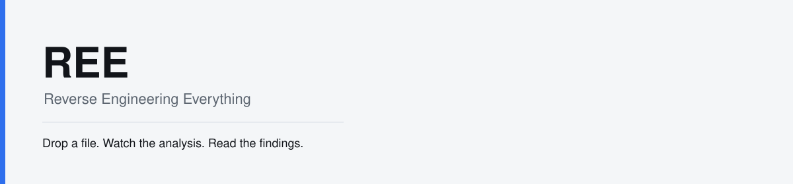

# REE

### Reverse Engineering Everything

**Preserve the intelligence. Expand the possibilities.**

A local investigation studio on the REA analysis engine.
Projects, fetches, and Evidence stay on your machine.

[](https://github.com/gryszzz/reverse-engineer-everything/actions/workflows/ci.yml)
[](https://github.com/gryszzz/reverse-engineer-everything/actions/workflows/rel-macos-smoke.yml)
[](https://gryszzz.github.io/reverse-engineer-everything/)
[](rel/MAC_SETUP.md)
[](.nvmrc)
[](LICENSE)

[Landing page](https://gryszzz.github.io/reverse-engineer-everything/) · [Get started](#get-started) · [Studio](#investigation-studio) · [Formats](#format-matrix) · [Outside-in](#outside-in) · [Roadmap](#roadmap) · [Safety](#safety-and-authorization)

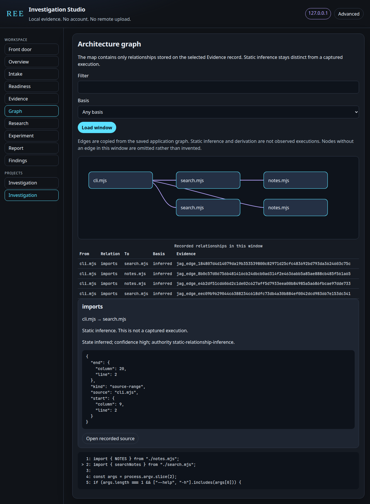

The picture is a live studio session in this checkout on Linux, Node 24.18.0. It analyzed the owned fixture `experiments/rel-first-lab`. Evidence id `ev_45d365f3b6f0be5b8831504b9bf5f268826bf0973e47a11ad01e1bd65587d58b`: 49 nodes, 67 edges, 7 files parsed, 0 parse failures. The selected edge is an inferred static import, not a captured execution.

</div>

## REE and REA

**REE** is this repository's product layer: the Investigation Studio, the beginner commands in `ree.mjs`, readiness checks, the unsigned `REE.app` bundle, and the opt-in `outside-in` public-document collector. **REA** is the inherited analysis engine and MCP server from [morluto/rea](https://github.com/morluto/rea). REE does not replace that engine, and it is not published as the `rea-agents` npm package.

`npx rea-agents setup` installs upstream REA, not this checkout. The package name and MCP id remain `rea-agents` and `io.github.morluto/rea`. Release jobs stay gated to `morluto/rea`.

The public landing page is [https://gryszzz.github.io/reverse-engineer-everything/](https://gryszzz.github.io/reverse-engineer-everything/). It is a static copy of this introduction. Analysis still runs only from a checkout.

This checkout is MIT, copyright (c) 2026 morluto. The license allows selling copies when [LICENSE](LICENSE) and [NOTICE](NOTICE) travel with them. `node ree.mjs edition` prints the draft split between the local studio and the pipeline commands. Both are in this checkout. There is no payment code and no license key. The pricing section on the landing page is a draft.

## What works today

| You can                                                                   | From                                                              |
| ------------------------------------------------------------------------- | ----------------------------------------------------------------- |
| Drop a file or folder, or paste a link and approve the fetch plan         | Studio front door                                                 |
| Create a project, resume it, classify an artifact, and read readiness     | Studio                                                            |
| Run a ready route and read sentences that point at saved Evidence         | Studio or `node ree.mjs analyze` for JavaScript / Electron / ASAR |
| Open a bounded graph of stored relationships and the recorded source line | Studio graph                                                      |
| Search saved Evidence                                                     | Studio Evidence, or [Evidence Explorer](rel/EVIDENCE_EXPLORER.md) |
| Compare two run summaries                                                 | `GET /api/projects/:id/diff` and the research DIFF stage          |
| Preview and approve one probe of `experiments/rel-first-lab`              | Studio experiment lab                                             |
| Restate saved records as Markdown                                         | Studio report                                                     |
| Write a behavior spec from public documents you name                      | `node ree.mjs outside-in`                                         |
| Use the full engine, including providers the studio does not launch       | `node scripts/rea.mjs` and the project MCP server                 |

The studio binds to `127.0.0.1` only. It has no account and does not upload Evidence. A link is fetched only after you approve the URLs, the size limit, and the destination. Research stages, when you turn them on, restate retained tool results. Remote model calls are refused.

## Investigation Studio

The studio is a loopback page served from this checkout. Simple Mode is the front door and Findings. Advanced Mode adds the rest of the rail. The labels on the page are the names below.

| Surface          | What it does                                                                                                                                                                                             |
| ---------------- | -------------------------------------------------------------------------------------------------------------------------------------------------------------------------------------------------------- |
| **Projects**     | The rail lists projects in the data directory. A drop or a link plan creates one named Investigation, with the question "What is this, in plain language?" Choosing a name resumes it.                   |
| **Front door**   | "Drop a file, folder, or paste a link." A drop is copied and classified. A link shows a fetch plan before any request.                                                                                   |
| **Findings**     | One sentence per saved fact. Each sentence names the Evidence id and path. Unknowns stay listed.                                                                                                         |
| **Overview**     | Artifact, run, and experiment counts, plus the latest Evidence id.                                                                                                                                       |
| **Intake**       | Heading "Artifact intake." Classifies a drop, a path, or the owned JavaScript fixture. It does not launch the target. You pick a ready route.                                                            |
| **Readiness**    | Heading "What this machine can actually do." Engine, studio, prerequisites, configured, and verified-on-this-host for each route.                                                                        |
| **Evidence**     | Search of the saved application graph. A hit is a recorded relationship.                                                                                                                                 |
| **Graph**        | Heading "Architecture graph." A window of stored edges. Positions are display-only. "Open recorded source" shows a few lines when the path stays inside a directory target.                              |
| **Research**     | Heading "Research notebook." Local stages are off until you enable them. They restate intake, Evidence, and saved comparisons.                                                                           |
| **Experiment**   | Heading "Experiment lab." One approved command: the owned notes search, query `bridge`.                                                                                                                  |
| **Report**       | Markdown that restates saved records. "Save report beside the project" writes `REE_STUDIO_REPORT.md`.                                                                                                    |
| **Summary diff** | Not a rail item. `GET /api/projects/:id/diff` compares summary counts and application-graph edge ids of two runs. The research DIFF stage restates that comparison. It is not an REA version comparison. |

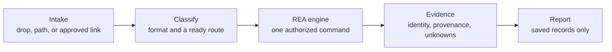

`outside-in` does not enter this flow. It writes a behavior spec from public documents and does not call the engine.

The pictures below are one live session on this Linux checkout, plus a fetch-plan frame that did not use the network. Nothing in them was drawn by hand.

### Front door

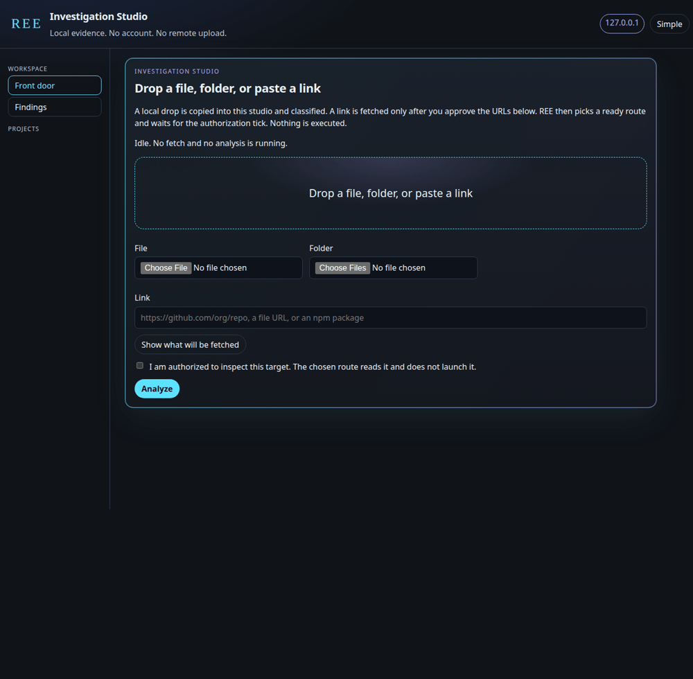

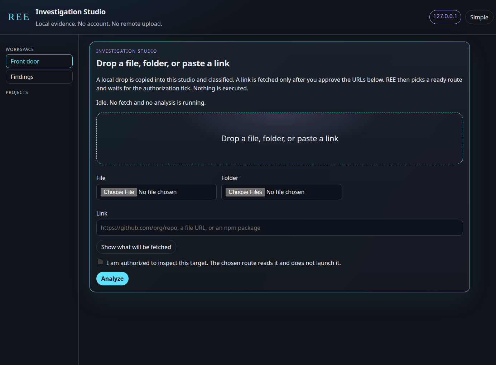

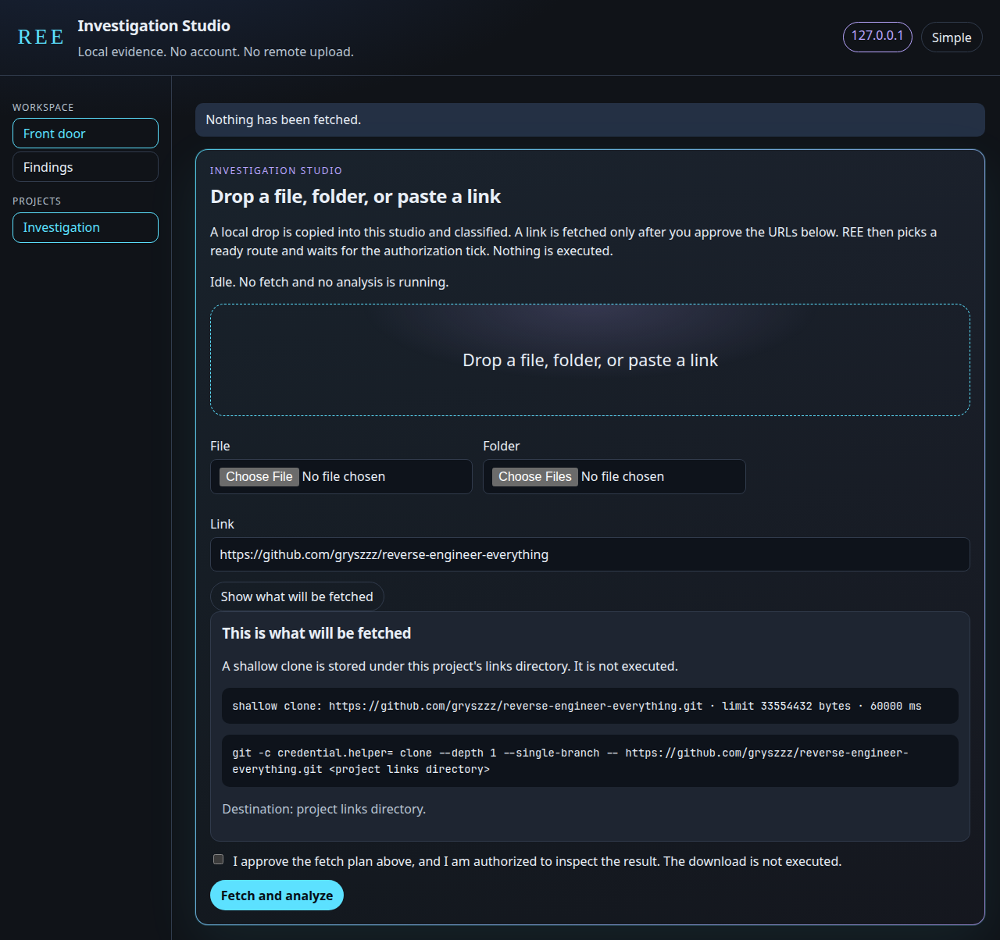

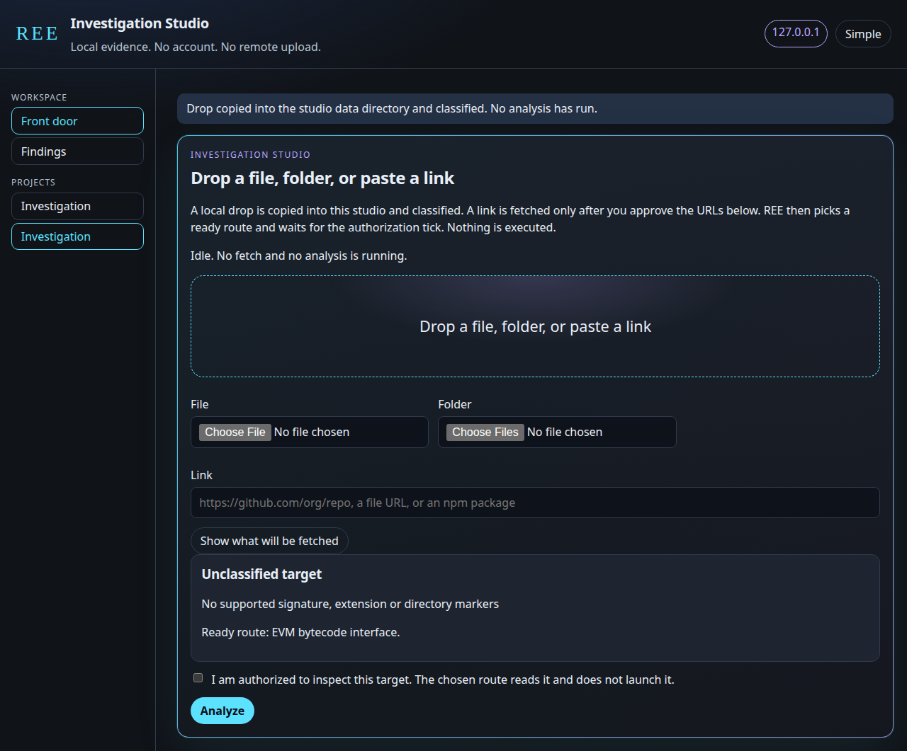

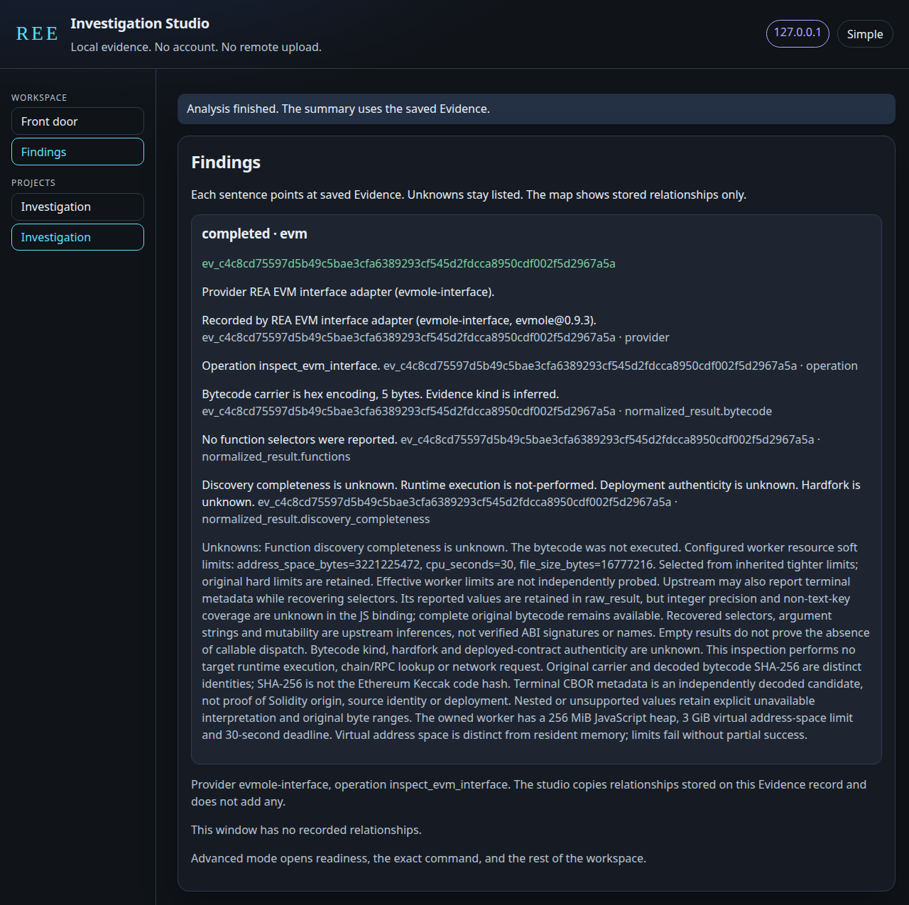

The plan lists `https://github.com/gryszzz/reverse-engineer-everything.git`, limit 33554432 bytes, timeout 60000 ms, and says nothing has been fetched. The drop is `experiments/ree-fixtures/carrier.hex`. The intake label is **Unclassified target**. The ready route is **EVM bytecode interface**. Findings quote Evidence `ev_c4c8cd75597d5b49c5bae3cfa6389293cf545d2fdcca8950cdf002f5d2967a5a` from `evmole@0.9.3`: hex encoding, 5 bytes, no function selectors reported, runtime execution not performed. The bytecode was not executed.

### Overview and intake

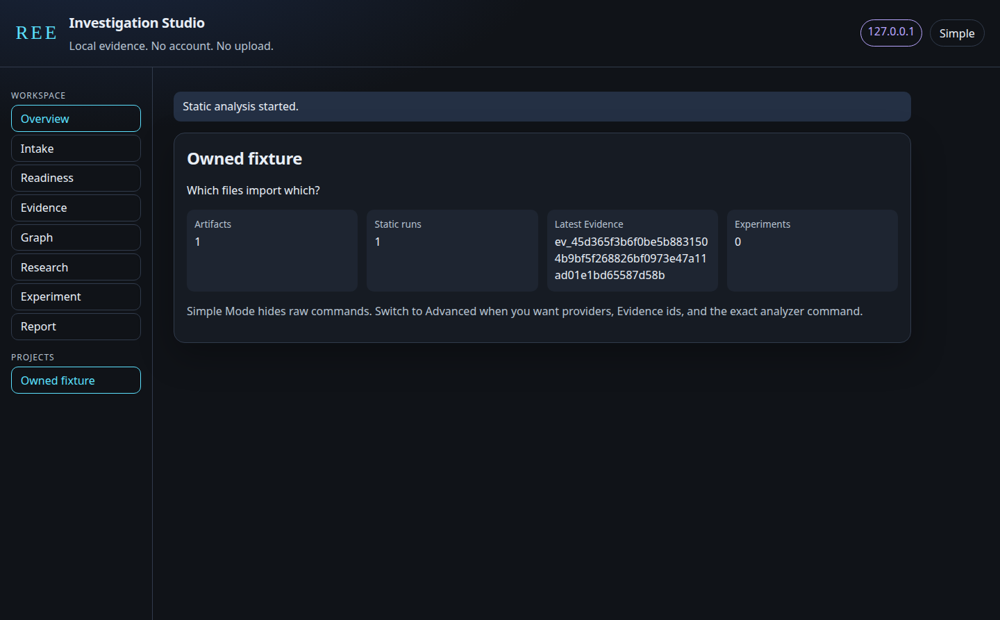

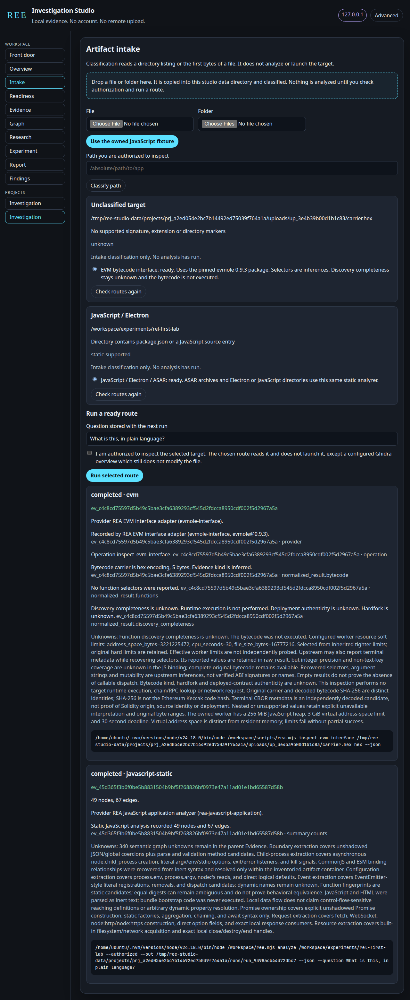

Classification reads a directory listing or the first bytes of a file. The authorization checkbox is required before a route runs. The JavaScript route reads source. It does not start the fixture.

### Readiness

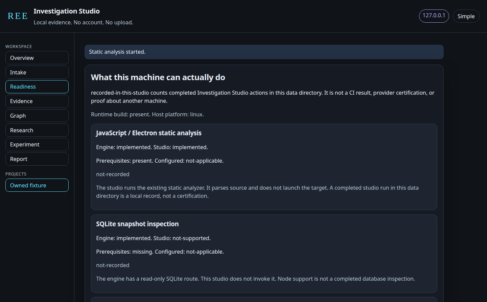

The picture is the top of the page on this Linux host after the session. JavaScript / Electron / ASAR and the EVM bytecode interface are `recorded-in-this-studio`. PE resources and objdump are ready and `not-recorded` here. WebAssembly and JADX are `not-configured`. apktool is `missing-tool`. Mach-O is `unsupported` on Linux because `inspect-macho` is a macOS route. `recorded-in-this-studio` means a completed action in this data directory. It is not a CI result and not a statement about another machine. A command on `PATH` is not treated as configured or verified.

### Evidence and the architecture graph

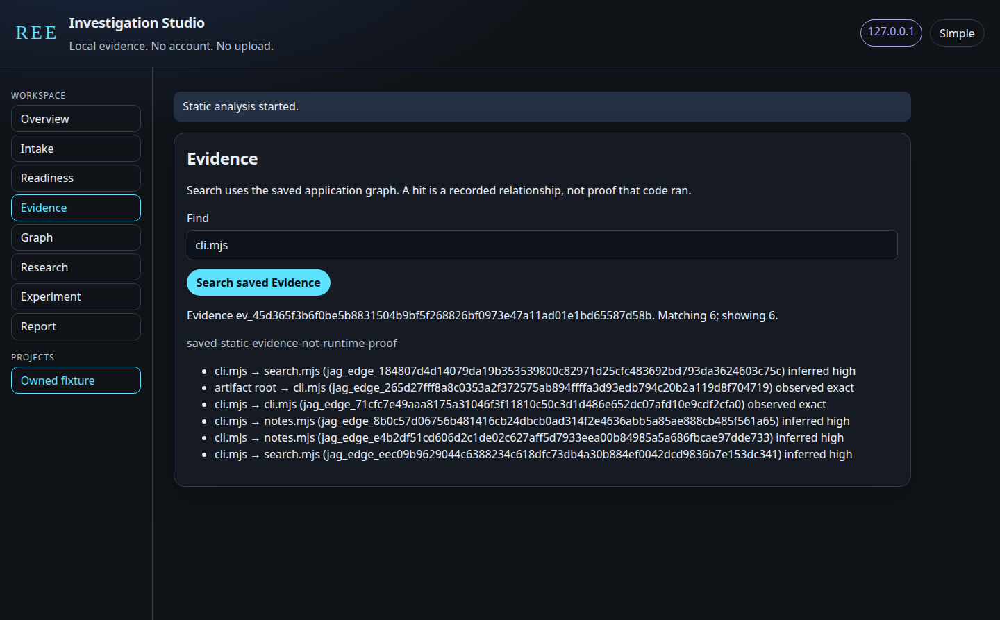

Search for `cli.mjs` returned 6 matching relationships and showed 6. The note on the result is `saved-static-evidence-not-runtime-proof`.

The graph at the top of this page is the same Evidence, filtered to `cli.mjs` and basis inferred. The selected edge is `cli.mjs` imports `search.mjs`, state inferred, confidence high, authority `static-relationship-inference`. The recorded line is `cli.mjs:2`, `import { searchNotes } from "./search.mjs"`. The window copies stored edges. It does not invent nodes for files that were not in that window.

### Experiment lab

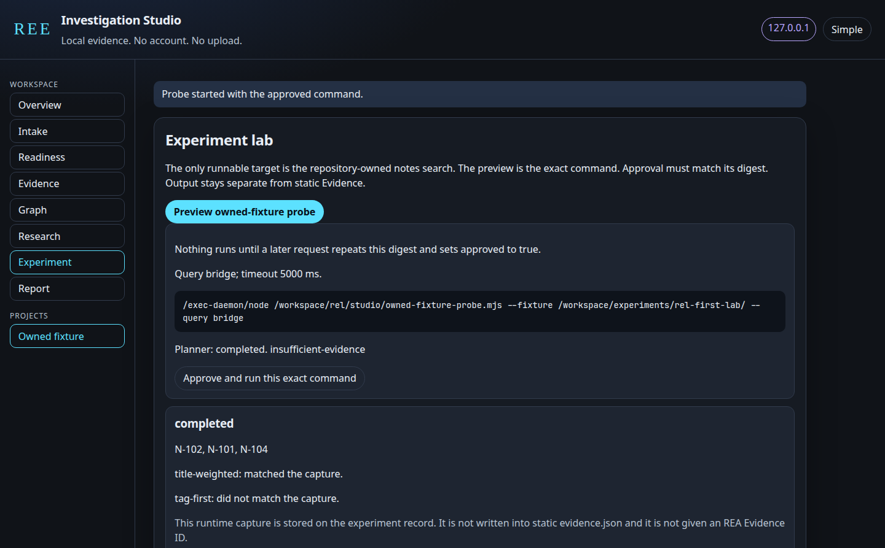

The preview is the exact command, query `bridge`, timeout 5000 ms. Nothing runs until the approved digest matches. This capture returned `N-102`, `N-101`, `N-104`. The caller-declared title-weighted prediction matched. The tag-first prediction did not. The finite-hypothesis planner, asked with no Evidence observations, reported `insufficient-evidence`. The capture is stored on the experiment record. It is not written into `evidence.json` and is not sent back to the planner, because this studio does not mint Evidence ids.

### Research notebook

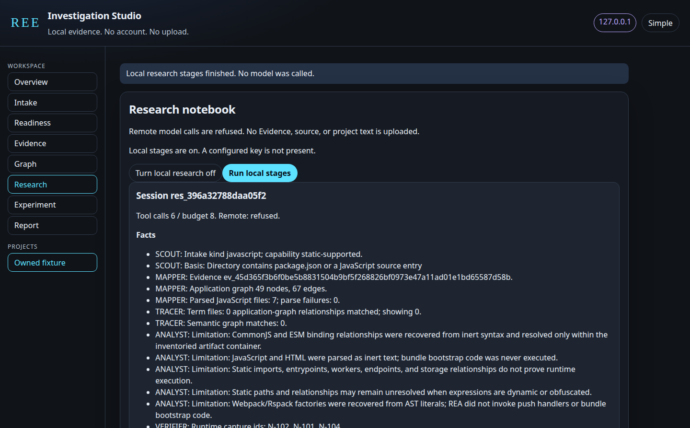

Local stages are off until you enable them. This session ran 6 tool calls against a budget of 8. Remote calls were refused. A configured key was not present. Facts restate the JavaScript Evidence id, 49 nodes, 67 edges, and 7 parsed files. The DIFF stage compared the EVM run and the JavaScript run by summary counts. It reported 3 relationship-count deltas and said it is not an REA version comparison. The question words did not produce a semantic answer: the tracer term `plain` matched 0 application-graph relationships, and that miss is not proof of absence. No hypotheses were produced.

### Report

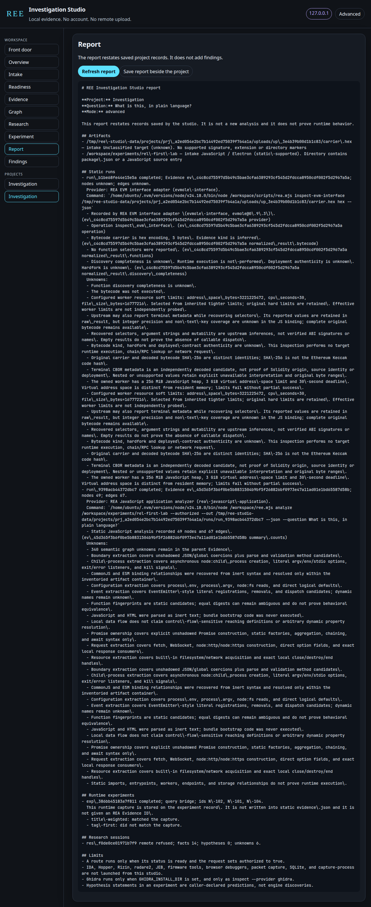

The report restates saved records. It does not add findings. Hyphens in the Markdown are escaped, so a path can show a backslash before a hyphen. That is the exporter, not a second analysis.

## Format matrix

Status words mean only this:

| Word                    | Meaning                                                                                           |
| ----------------------- | ------------------------------------------------------------------------------------------------- |
| **Implemented**         | This checkout runs it, including from the studio or `ree.mjs`.                                    |
| **Experimental**        | A bounded path with an explicit limit.                                                            |
| **Needs configuration** | The engine has the route. An absolute tool path is still required.                                |
| **Needs external tool** | You supply the tool. The studio does not install it, except the approved `apktool` command below. |
| **Needs macOS**         | The route reads macOS tools. On Linux the studio reports it unsupported.                          |
| **Unsupported**         | The studio refuses it, or it has no such action.                                                  |

| Route                                                                                      | Engine                                                                        | Studio                                                                                                                                | Status                  |
| ------------------------------------------------------------------------------------------ | ----------------------------------------------------------------------------- | ------------------------------------------------------------------------------------------------------------------------------------- | ----------------------- |
| JavaScript / Electron / ASAR static analysis                                               | Implemented                                                                   | Runs the existing analyze route when the runtime is built                                                                             | **Implemented**         |
| Drop a file or folder                                                                      | REE product                                                                   | Local copy, then the ready route                                                                                                      | **Implemented**         |
| Approved https link, shallow GitHub/GitLab clone, npm tarball, page and referenced scripts | REE product                                                                   | Opt-in. Size and time limits. URL and sha256 kept. Not executed                                                                       | **Implemented**         |
| PE resource inventory                                                                      | Implemented                                                                   | `inspect-pe-resources` when the file is a PE. Resources only. It does not decompile                                                   | **Implemented**         |
| EVM bytecode interface                                                                     | Implemented                                                                   | `evmole` 0.9.3 in this checkout. Selectors are inferences. The bytecode is not executed                                               | **Implemented**         |
| objdump file headers                                                                       | Implemented                                                                   | Runs when `objdump` is on `PATH`                                                                                                      | **Implemented**         |
| Evidence search and bounded relationship graph                                             | Implemented                                                                   | Uses saved Evidence                                                                                                                   | **Implemented**         |
| Project save / resume, intake, readiness, report, summary diff                             | REE product                                                                   | Implemented                                                                                                                           | **Implemented**         |
| WebAssembly                                                                                | Implemented                                                                   | Needs absolute `REA_WABT_BIN_DIRECTORY` for WABT 1.0.42. A `wabt` binary on `PATH` is not configured                                  | **Needs configuration** |
| ELF layout                                                                                 | Implemented                                                                   | Needs absolute `REA_PWNTOOLS_PYTHON` on Linux x64. REE does not install Python                                                        | **Needs configuration** |
| Android JADX                                                                               | Implemented                                                                   | Needs absolute `REA_JADX_MCP_JAR` for jadx-headless-mcp 0.7.1, and `java` on `PATH`. A Homebrew `jadx` is not that jar                | **Needs configuration** |
| Apktool                                                                                    | Implemented                                                                   | `apktool` on `PATH` or `REA_APKTOOL_COMMAND`. On macOS the studio can run `brew install apktool` only after the exact argv and digest | **Needs external tool** |
| Mach-O overview                                                                            | Implemented                                                                   | `otool` and `lipo` on macOS                                                                                                           | **Needs macOS**         |
| Ghidra overview                                                                            | Implemented                                                                   | `inspect --provider ghidra` only when `GHIDRA_INSTALL_DIR` is set. It does not modify the file                                        | **Needs configuration** |
| Owned `experiments/rel-first-lab` probe                                                    | Not an engine route                                                           | One approved command, query `bridge`                                                                                                  | **Experimental**        |
| Finite hypothesis planner                                                                  | Implemented                                                                   | Preview with no observations reports insufficient evidence                                                                            | **Experimental**        |
| Local research stages                                                                      | Not an engine route                                                           | Off by default. Restates saved results                                                                                                | **Experimental**        |
| `outside-in` public behavior spec                                                          | Not an engine route                                                           | Not in the studio. Opt-in CLI                                                                                                         | **Experimental**        |
| Remote model commentary                                                                    | None                                                                          | Refused, even if a key is stored                                                                                                      | **Unsupported**         |
| IDA, Hopper, Rizin, radare2, JEB                                                           | IDA, Hopper, and Rizin exist as engine adapters. There is no radare2 provider | The studio does not launch them                                                                                                       | **Unsupported**         |
| SQLite, firmware, packet capture, browser runtime, process capture                         | Implemented on the engine                                                     | Not invoked by the studio                                                                                                             | **Needs external tool** |

SQLite inspection wants Node 24.15+ or 26+. A missing `ghidra` or `hopper` command does not prove the Mac app is absent, and a command on `PATH` does not prove a decompilation. Process capture is an engine workflow with its own host and authority rules. The studio experiment does not call it.

Guides for the engine routes stay in the [upstream README](UPSTREAM_REA_README.md) and the [documentation index](docs/index.md): [JavaScript](docs/javascript-application-workflows.md), [native](docs/native-investigation.md), [Android](docs/android-analysis.md), [firmware](docs/firmware-analysis.md), [WebAssembly](docs/wasm-artifacts.md), [SQLite](docs/sqlite-databases.md), [browser](docs/browser-observation.md), [packets](docs/pcap-analysis.md), [process capture](docs/process-capture.md).

Native example, when you already have a provider:

```sh
node scripts/rea.mjs inspect /absolute/path/to/program --provider ghidra --json
```

REE does not silently substitute one native engine for another.

## Outside-in

`outside-in` studies a product from public documents when you do not have its code. It writes a versioned behavior spec that another system can read. The command is opt-in. `inspect`, `analyze`, the Investigation Studio, and the REA engine keep their current behavior. It does not need `npm run build:cached`. It does not use a browser.

```sh
node ree.mjs outside-in \
  --name "Widget Cloud" \
  --url https://widgets.example/ \
  --docs https://widgets.example/openapi.yaml \
  --out /tmp/widgets-spec \
  --json
```

`--out` must sit outside this repository. `--json` prints the spec on stdout. `--fixture rel/outside-in/fixtures/product` reads a local fixture and does not open a network connection.

The collector fetches only the https URLs you list, plus `robots.txt` for those origins. It obeys `robots.txt` and fails closed when robots cannot be read. It sends no cookies and no `Authorization` header. It does not follow redirects, does not log in, and does not solve a captcha. Loopback and private hosts are refused. Source and binary filenames are not fetched. Quotes in the spec are at most 160 characters, and a similarity guard redacts longer unmarked verbatim runs. `--summarizer remote` is refused. The spec does not create Evidence ids.

Boundaries, the exit codes, and the schema are in [rel/outside-in/README.md](rel/outside-in/README.md).

## Get started

> **Distribution:** these steps run this checkout. They do not publish REE and they do not install upstream `rea-agents`.

Node 24 is required for the pinned toolchain. `.nvmrc` is **24.18.0** and `package.json` pins **npm 11.16.0**.

```sh
git clone https://github.com/gryszzz/reverse-engineer-everything.git
cd reverse-engineer-everything
nvm use 24
node -v
```

`nvm use` with no argument also selects the version in `.nvmrc`. `doctor` and an empty studio also run on the engine range `^22.19.0 || ^24.11.0 || >=26.0.0`. The analyzer and the screenshots above were run on the pinned Node 24.

### Mac app

From the checkout, after `nvm use 24`:

```sh
node ree.mjs doctor
npm ci
npm run build:cached
node ree.mjs app build
node ree.mjs app install
```

Then open **REE** from `~/Applications` or the Desktop link. Install asks Finder for an alias and kills that request if it has not finished in five seconds, then leaves a symlink. The build records this checkout and the Node binary you used. Rebuild after either one moves.

`node ree.mjs app build` compiles the WebKit window with `swiftc`. It uses `swiftc` on `PATH` when that runs, and otherwise `xcrun -f swiftc` and `xcrun --sdk macosx -f swiftc`, including `/usr/bin/xcrun` when the Command Line Tools compiler is not on `PATH`. It sets `SDKROOT` from `xcrun --sdk macosx --show-sdk-path` and passes `-sdk` plus that path to `swiftc`. A compiler on `PATH` can still fail to load the standard library for `arm64-apple-macos12.0` without that SDK, so the build does not run `swiftc` when the SDK path is missing. It tries an Apple Silicon slice and an Intel slice and combines them when both compile. A failed build deletes the partial `REE.app` it just created. The bundle id is `io.github.gryszzz.ree.studio`, the display name is **REE**, and the icon is the graphite mark in `rel/app/mac/AppIcon.svg`.

The bundle is unsigned and not notarized. If macOS says it cannot be opened, right-click `REE.app`, choose **Open**, then **Open**. That leaves Gatekeeper on. Closing the window stops the studio. A second launch focuses the running app. If Node.js cannot be found, the app shows an alert instead of a blank window.

`Start-REE-Studio.command` and `node ree.mjs studio --open` open the same page in your browser and leave a Terminal window running. `Start-REE.command` is the separate visual lesson, not the studio.

Details: [Investigation Studio](docs/investigation-studio.md) and [Mac setup](rel/MAC_SETUP.md).

### Terminal

```sh
nvm use 24
node ree.mjs doctor
node ree.mjs studio --open
```

On a Mac, projects are stored in `~/Library/Application Support/REE/studio` unless you pass `--data DIR`. On Linux the default is `$XDG_DATA_HOME/ree/studio` or `~/.local/share/ree/studio`. That directory must sit outside the checkout. The page is only `http://127.0.0.1:<port>/`.

Build, then analyze the owned example. The demo command is the source-owned lab:

```sh
npm ci
npm run build:cached

OUT="$(mktemp -d)/ree-demo"
node ree.mjs demo --run --out "$OUT"
```

In the studio: create a project by dropping a file or choosing **Use the owned JavaScript fixture**, check the authorization box, and run static analysis. Open Evidence and search `cli.mjs` or `search.mjs`. Open Graph and select an inferred edge.

For a JavaScript or Electron tree you are allowed to inspect:

```sh
node ree.mjs inspect /absolute/path/to/app

OUT="$(mktemp -d)/ree-investigation"
node ree.mjs analyze /absolute/path/to/app \
  --authorized \
  --out "$OUT" \
  --question "Which files import which?"
```

`inspect` classifies. `analyze` parses source. It does not launch the target. Choose a new output directory outside both the target and this checkout. The question is kept in the REE report. It is not a new engine argument.

Saved files are `evidence.json`, `summary.json`, `view-evidence.json`, and `REE_EVIDENCE_REPORT.md`. Browse them with [Evidence Explorer](rel/EVIDENCE_EXPLORER.md):

```sh
node rel/evidence-explorer.mjs "$OUT/evidence.json" --find cli.mjs --limit 12
```

## Safety and authorization

- The studio and `REE.app` listen on `127.0.0.1` only. Other hosts and other origins are refused. There is no account and no remote upload.
- A pasted link shows the URL, byte limit, time limit, and destination before anything is fetched. `approved` must be boolean true and the digest must match. `http`, credentials, and non-public addresses are refused. The bytes are stored and hashed. They are not executed.
- Static analysis starts only after you set authorization. The child process is the public engine command for that route. One run at a time, three-minute timeout, then SIGTERM and SIGKILL.
- The owned probe lists its argv, timeout, and file hashes. A digest mismatch is rejected. `approved` must be boolean true. Any other directory is refused. Analysis authorization does not approve the probe.
- Runtime capture stays on the experiment record. It is not merged into static Evidence.
- Research does not call a model. A configured key is not returned to the page and is not sent.
- `outside-in` is opt-in. It fetches only the public https URLs you name, plus `robots.txt`. It does not run during studio startup, `inspect`, or `analyze`. It sends no credentials and does not call a model.
- Child analysis environments are an allowlist. The ambient environment is not saved as evidence.
- The app does not install Node, Homebrew, Ghidra, IDA, Hopper, or anything else. If Node is missing, it stops with an explanation.

## CLI and MCP

Beginner REE commands:

| Command                                                   | What it does                                      |
| --------------------------------------------------------- | ------------------------------------------------- |
| `node ree.mjs doctor`                                     | Read-only host and toolchain report               |
| `node ree.mjs inspect TARGET`                             | Classify. Do not analyze                          |
| `node ree.mjs analyze TARGET --authorized --out DIR`      | Static JavaScript / Electron                      |
| `node ree.mjs demo`                                       | Preview the owned lab                             |
| `node ree.mjs demo --run --out DIR`                       | Analyze the owned lab and run its checks          |
| `node ree.mjs studio`                                     | Loopback Investigation Studio                     |
| `node ree.mjs app build`                                  | Build unsigned `REE.app` on macOS                 |
| `node ree.mjs app install`                                | Copy it to `~/Applications` and alias the Desktop |
| `node ree.mjs outside-in --name NAME --url URL --out DIR` | Public-docs behavior spec. No target source       |
| `node ree.mjs lab`                                        | Visual lesson, separate from the studio           |
| `node ree.mjs codex`                                      | Check this checkout's Codex project files         |

The engine commands and MCP tools are unchanged. Representative pairs:

| Task                                  | CLI                              | MCP                              |
| ------------------------------------- | -------------------------------- | -------------------------------- |
| Inspect an analysis view              | `inspect-analysis-view`          | `inspect_analysis_view`          |
| Trace an application feature          | `trace-application-feature`      | `trace_application_feature`      |
| Compare application versions          | `compare-application-versions`   | `compare_application_versions`   |
| Capture a process scenario            | `capture-process`                | `capture_process_scenario`       |
| Select a finite hypothesis probe      | `discriminate-finite-hypotheses` | `discriminate_finite_hypotheses` |
| Verify selected reconstruction claims | `verify-reconstruction`          | `verify_reconstruction`          |

```sh
node scripts/rea.mjs --help
node ree.mjs codex
```

Contracts: [CLI](docs/cli.md), [MCP](docs/mcp-contracts.md). Codex setup for this checkout: [rel/CONNECT_CODEX.md](rel/CONNECT_CODEX.md). `node ree.mjs codex` checks local files. It does not prove a live MCP session. The MCP server has more authority than the beginner static command. Keep the target and the permitted actions explicit.

The finite planner ranks caller-supplied predictions. It does not invent hypotheses or launch a target. The owned C fixture under `experiments/ree-investigation-boundary/` is a separate bounded experiment and wants macOS, Clang, and a built runtime: `npm run verify:ree-investigation-boundary -- /tmp/ree-c-investigation`. A counterexample there refutes that candidate for the chosen case. It is not a general equivalence certificate. See [reconstruction reports](docs/reconstruction-reports.md).

## Roadmap

These items are planned. They are not commands, views, or routes in this checkout.

| Planned                        | What exists instead                                                                                                                                                              |
| ------------------------------ | -------------------------------------------------------------------------------------------------------------------------------------------------------------------------------- |
| **Live Investigation Theater** | The experiment lab runs one approved command and stores the capture on the experiment record. The studio does not present a live execution.                                      |
| **Rebuild Studio**             | `verify-reconstruction` remains an engine CLI command and an MCP tool. Studio Build scaffolds a clean-room folder from a behavior spec. It does not rebuild the analyzed target. |
| **Actions and exports**        | The report view can save its Markdown beside the project. There is no general action or export palette.                                                                          |
| **Headless `ree serve`**       | The loopback server command is `node ree.mjs studio`. There is no `ree serve` command.                                                                                           |

## Limitations

- There is no separate published REE package, updater, or notarized app.
- Ghidra runs only as `inspect --provider ghidra` when `GHIDRA_INSTALL_DIR` is already set. IDA, Hopper, Rizin, radare2, and JEB are not launched from the studio. Firmware tools, browser debuggers, packet capture, SQLite, and `capture-process` are not launched from the studio.
- WebAssembly, ELF layout, and JADX stay not-configured until the documented absolute tool path is set. The studio does not install WABT, Python, JADX, or Ghidra.
- A static graph edge is not an observed execution.
- The probe cannot target anything except `experiments/rel-first-lab`, and the command it runs is the `bridge` query.
- Research has no model cost because no model is called.
- Evidence browsing stops at the existing 64 MiB explorer limit. The graph window is at most 200 application edges, or 40 semantic relations.
- Source excerpts open only when the recorded path stays inside a directory target.
- Outside-in does not render JavaScript, follow redirects, or log in. A client-rendered page can produce an empty spec.
- `REE.app` points at the checkout path saved when you built it. Moving the repo without rebuilding breaks the app until you build again.
- Force-quit can leave the server process. The next launch stops a recorded leftover server, then starts a new one.
- These studio pictures were captured from the live page over loopback. They are not a substitute for a provider run you have not done.

## Architecture

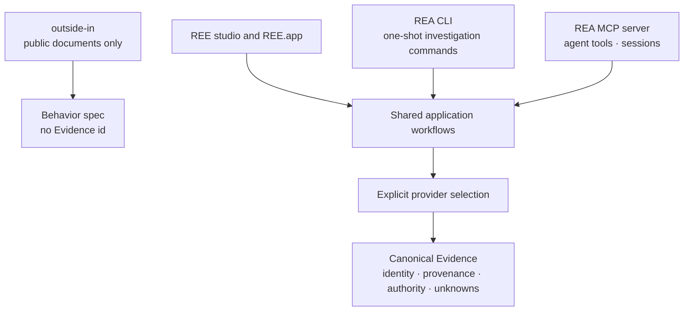

`outside-in` is a `ree.mjs` command. It does not call the shared workflows or mint Evidence.

| Layer                                     | Source                                                                                       |
| ----------------------------------------- | -------------------------------------------------------------------------------------------- |
| REE entry, studio, app bundle, outside-in | [`ree.mjs`](ree.mjs), [`rel/`](rel/), [`Start-REE-Studio.command`](Start-REE-Studio.command) |
| REA workflows, providers, Evidence        | [`src/`](src/), [`scripts/rea.mjs`](scripts/rea.mjs), [`bridge/`](bridge/)                   |
| Owned JavaScript fixture                  | [`experiments/rel-first-lab/`](experiments/rel-first-lab/)                                   |

The map is the system, not one command that analyzes every file type. See the [engineering map](docs/ree-engineering-map.md) and [product readiness notes](docs/ree-product-readiness.md).

| Interpretation | What it means                                                |
| -------------- | ------------------------------------------------------------ |
| **Observed**   | Present in the supplied artifact or captured event           |
| **Derived**    | Produced by a parser or an explicit rule                     |
| **Inferred**   | Supported by observations, with the inference boundary kept  |
| **Unknown**    | Unselected, unsupported, ambiguous, truncated, or unobserved |

Static reachability does not prove execution. A missing match does not prove a behavior is absent.

## License and attribution

REE builds on **[morluto/rea](https://github.com/morluto/rea)**. The inherited engine, providers, technical guides, [upstream README](UPSTREAM_REA_README.md), [MIT license](LICENSE), and [third-party notices](THIRD_PARTY_NOTICES.md) are preserved. This repository does not claim authorship of that foundation.

Contributions should preserve provider boundaries, Evidence provenance, platform workflows, and that attribution. See [CONTRIBUTING.md](CONTRIBUTING.md).
