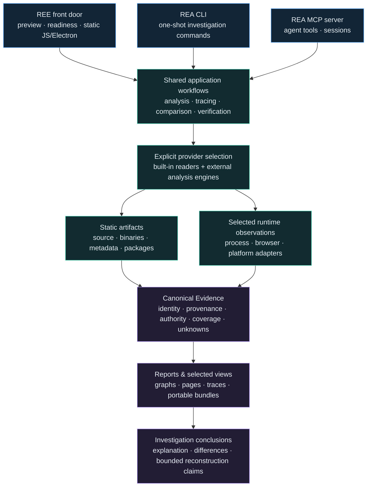

<div align="center">

# REE

### Reverse Engineering Everything

**Preserve the intelligence. Expand the possibilities.**

A local investigation workbench for software structure, runtime behavior, and evidence.
Built on the REA engine, with a simpler entry point and its full analysis foundation retained.

[](https://github.com/gryszzz/reverse-engineer-everything/actions/workflows/ci.yml)
[](https://github.com/gryszzz/reverse-engineer-everything/actions/workflows/rel-macos-smoke.yml)
[](.nvmrc)
[](#cli-and-mcp)
[](LICENSE)

[Get started](#get-started) · [Capabilities](#capability-map) · [Architecture](#architecture) · [Evidence](#the-evidence-model) · [Codex](#connect-codex) · [Readiness](#status-and-readiness)


</div>

## What REE gives you

REE brings a broad reverse-engineering engine into an evidence-centered investigation workflow. Start with an artifact and a question, select an appropriate analysis route, inspect the findings, and retain what supports each conclusion.

| You want to…                     | REE / REA provides                                                                                                   |
| -------------------------------- | -------------------------------------------------------------------------------------------------------------------- |
| Understand an application        | Static module graphs, imports, entry points, feature traces, source locations, and provider-specific code inspection |
| Inspect compiled software        | Native function inventories, disassembly, decompilation, references, types, and specialist artifact readers          |
| Follow behavior across layers    | Static and supplied runtime Evidence, browser/Electron observations, managed/native boundaries, and process captures |
| Explain a change                 | Version, artifact, function, source-to-bundle, and selected behavioral comparisons                                   |
| Test an explanation              | Finite hypothesis selection, controlled experiments, reconstruction obligations, and scoped verification             |
| Keep an investigation reviewable | Identified Evidence records, coverage, limitations, unknowns, selected views, and portable bundles                   |

**REE** is this independent project's identity, beginner CLI, and onboarding. **REA** is the inherited analysis engine and MCP server. The Mac-first front door complements the existing engine, including its Linux and Windows workflows, provider families, and advanced tools.

The current beginner `analyze` command runs static JavaScript/Electron analysis. Other artifact families use their existing REA CLI/MCP routes and matching prerequisites. REE is developed from this source checkout; the upstream `rea-agents` npm package is a separate distribution.

## Get started

> **Distribution status:** REE does not have a separate published npm package
> or release yet. The steps below run this repository checkout. `npx
> rea-agents setup` installs the upstream REA package, not this fork; the
> inherited [REA setup guide](docs/installation.md) documents that package.

### 1. Open the workbench

Clone this repository, then use the pinned toolchain: **Node 24.18.0** and **npm 11.16.0**. The commands below assume those versions are already available; `nvm use` selects the repository's Node version when using nvm. The quick-start shell examples use macOS/Linux syntax; Windows workflows are documented in the matching provider guides.

```sh
git clone https://github.com/gryszzz/reverse-engineer-everything.git
cd reverse-engineer-everything
nvm use

node ree.mjs doctor
node ree.mjs lab --open
```

`doctor` reports selected host and toolchain facts without installing software. `lab` opens a fictional, local teaching exercise; it needs no REA build. It explains analysis relationships and is separate from live target analysis.

On macOS, [`Start-REE.command`](Start-REE.command) also opens the lesson from Finder. Keep its Terminal window open while the lesson runs. If macOS blocks the unsigned launcher, use `zsh ./Start-REE.command` from the checkout.

### 2. Build and run the owned example

```sh
npm ci
npm run build:cached

OUT="$(mktemp -d)/ree-demo"
node ree.mjs demo --run --out "$OUT"
cat "$OUT/REE_EVIDENCE_REPORT.md"
```

This analyzes the repository's own JavaScript example and runs its owned lesson checks. It retains the complete analysis plus a smaller summary and a readable report. The separate [C investigation example](#from-a-hypothesis-to-an-experiment) explores bounded behavioral reconstruction.

### 3. Inspect your application

For a JavaScript/TypeScript source directory, an extracted Electron application, or an Electron ASAR you are authorized to inspect:

```sh
node ree.mjs inspect /absolute/path/to/app

OUT="$(mktemp -d)/ree-investigation"
node ree.mjs analyze /absolute/path/to/app \
  --authorized \
  --out "$OUT" \
  --question "How does the settings screen load and persist preferences?"

cat "$OUT/REE_EVIDENCE_REPORT.md"
```

This route parses source and package files as data. The application is not launched. The question is saved as investigation context; the command produces a static graph and report for you or your agent to investigate, rather than automatically answering arbitrary questions.

Choose a **new output directory** outside both the target and this checkout, with an existing parent. Source selection is bounded: unselected files, dynamic behavior, and unresolved relationships remain explicit unknowns.

<details>
<summary><strong>What is saved, and how do I explore it?</strong></summary>

| File                     | Purpose                                                                    |
| ------------------------ | -------------------------------------------------------------------------- |
| `REE_EVIDENCE_REPORT.md` | Readable entry point with coverage, limitations, and investigation context |
| `summary.json`           | Graph identities, counts, coverage, unknowns, and run metadata             |
| `view-evidence.json`     | Engine-produced summary linked to the parent Evidence                      |
| `evidence.json`          | Complete retained analysis record for deeper inspection                    |

Browse recorded JavaScript relationships with the existing Evidence Explorer:

```sh
node rel/evidence-explorer.mjs "$OUT/evidence.json" --limit 12
node rel/evidence-explorer.mjs "$OUT/evidence.json" --find settings --json
node rel/evidence-explorer.mjs "$OUT/evidence.json" --dot
```

The explorer is a local CLI projection over saved application graphs, with a 64 MiB input limit. It preserves source links and uncertainty; it does not independently revalidate Evidence digests. For larger records, start with the report or the engine's bounded analysis views. See [Evidence Explorer](rel/EVIDENCE_EXPLORER.md).

</details>

## Capability map

These are routes present in the REA engine. A listed route, an installed dependency, provider discovery, and a verified run are different states. Follow each guide for exact formats, host support, authority, and prerequisites.

| Artifact / domain                    | Available investigation routes                                                                                                   | Requirements and guide                                                                                                                                                             |
| ------------------------------------ | -------------------------------------------------------------------------------------------------------------------------------- | ---------------------------------------------------------------------------------------------------------------------------------------------------------------------------------- |
| **JavaScript, TypeScript, Electron** | Directory/ASAR graphs, static semantic relations, feature traces, version and export-shape comparisons, source-to-bundle mapping | Built-in static route; [application graph](docs/javascript-application-graph.md), [workflows](docs/javascript-application-workflows.md)                                            |
| **Native executables and libraries** | Function inventories, instructions, pseudocode, references, types, bounded static traces                                         | Selected, compatible Ghidra, Hopper, or IDA; [native investigation](docs/native-investigation.md)                                                                                  |
| **ELF layouts and recorded crashes** | Binary layouts, mappings, core-file and crash inspection                                                                         | Route-specific offline tools and host requirements; [binary layout](docs/binary-diagnostics.md), [recorded crashes](docs/recorded-crashes.md)                                      |
| **Go and Rust binaries**             | Compiler/runtime metadata and package or dependency information where present                                                    | Metadata availability depends on the artifact; [Go](docs/go-binaries.md), [Rust](docs/rust-binaries.md)                                                                            |
| **Managed .NET**                     | PE/CLI metadata, members, IL, application graphs, comparisons, managed/native boundaries                                         | Static metadata workflow with declared coverage; [managed analysis](docs/managed-code-analysis.md)                                                                                 |
| **Android and mobile layers**        | APK inventory, code/resource inspection, application graphs, selected Apktool, ADB, JEB, and Flutter workflows                   | Caller-supplied tools and route-specific device/execution scope; [Android](docs/android-analysis.md)                                                                               |
| **Apple artifacts**                  | Package and native-resource inspection, platform metadata, UI resources, selected desktop/runtime workflows                      | Artifact- and host-specific routes; [Apple artifacts](docs/apple-application-analysis.md), [native guide](docs/native-investigation.md)                                            |
| **Firmware and raw binaries**        | Format and region inspection, extraction, selected native analysis profiles                                                      | Caller-supplied Binwalk/Unblob or matching native toolchain; [firmware](docs/firmware-analysis.md), [raw binaries](docs/raw-binary.md)                                             |
| **WebAssembly**                      | Module/artifact inspection and interface comparisons                                                                             | Compatible caller-supplied WABT; [WebAssembly](docs/wasm-artifacts.md)                                                                                                             |
| **EVM bytecode**                     | Offline bytecode and inferred interface inspection, metadata-oriented workflows                                                  | Route-specific carrier and inference limits; [EVM](docs/evm-bytecode.md)                                                                                                           |
| **SQLite**                           | Read-only database snapshot inspection                                                                                           | Node 24.15+ or 26+ for native SQLite; [databases](docs/sqlite-databases.md)                                                                                                        |
| **Browser and Electron runtime**     | Captured scripts, source maps, module relationships, runtime observations, selected static/runtime reconciliation                | Matching browser, Electron, Inspector, or observation provider; [browser analysis](docs/browser-observation.md), [JavaScript observations](docs/javascript-runtime-observation.md) |
| **Recorded network and signal data** | Packet/capture inspection, recorded web traffic, signal recordings                                                               | Matching parser or specialist toolchain; [PCAP](docs/pcap-analysis.md), [web captures](docs/web-network-captures.md), [signals](docs/signal-recordings.md)                         |
| **Process behavior**                 | Bounded PTY scenarios, terminal/process/filesystem observations, comparisons and trace claims                                    | Supported capture host and explicit target scope; [process capture](docs/process-capture.md)                                                                                       |

For the larger inherited capability catalog and additional client/provider guides, see the preserved [upstream README](UPSTREAM_REA_README.md) and [documentation index](docs/index.md).

### Native analysis from this checkout

Select a provider you have installed and configured. For example, with Ghidra:

```sh
node scripts/rea.mjs inspect /absolute/path/to/program --provider ghidra --json
node scripts/rea.mjs search /absolute/path/to/program entry \
  --kind procedures --provider ghidra --json
```

Choose an exact procedure name or address from the inventory, then use `function`, `instructions`, `decompile`, or `xrefs` as documented in the [native guide](docs/native-investigation.md). Provider licensing, supported architectures, GUI/headless behavior, and lifecycle requirements differ. REE does not silently substitute one native engine for another.

## Architecture

The system separates user entry points, shared investigation workflows, provider adapters, and domain semantics. Provider protocols stay in their adapters; Evidence and comparison rules remain reusable across CLI and MCP consumers.



| Layer                    | Responsibility                                                                             | Source                                                     |
| ------------------------ | ------------------------------------------------------------------------------------------ | ---------------------------------------------------------- |
| Entry points             | Beginner interaction, one-shot commands, and stdio MCP dispatch                            | [`ree.mjs`](ree.mjs), [`scripts/rea.mjs`](scripts/rea.mjs) |
| Public contracts         | Named tool schemas, examples, outputs, declared effects, and client-facing semantics       | [`src/contracts/`](src/contracts/)                         |
| Application workflows    | Shared analysis, evidence navigation, traces, comparisons, and reconstruction services     | [`src/application/`](src/application/)                     |
| Composition and sessions | Provider factories, explicit routing, target/session binding, retained investigation state | [`src/composition/`](src/composition/)                     |
| Providers and bridges    | Format readers, native engines, platform APIs, browser protocols, and tool adapters        | [`src/`](src/), [`bridge/`](bridge/)                       |
| Domain model             | Evidence identity, graph semantics, unknowns, comparison rules, and verification contracts | [`src/domain/`](src/domain/)                               |
| Process foundation       | Owned processes, resource bounds, cancellation, private workspaces, and cleanup            | [`src/process/`](src/process/)                             |

The diagram shows the shared system, not a single automatic analyze-everything command. Static analysis and runtime capture retain their different authority. The JavaScript semantic graph can follow backward provenance, forward influence, callers and ownership, including selected closure, Promise, event, timer and resource relations; unresolved dynamic behavior remains unknown. See the [engineering map](docs/ree-engineering-map.md), [detailed architecture](docs/architecture.mermaid), and [workflow design](docs/fork-investigation-workflows.md).

## The Evidence model

An explanation is useful when another person can inspect what supports it. REA's Evidence records preserve the artifact and operation identities, provider, confidence, authority, source locations, coverage, limitations, and links to related records. Reports and selected views point back to those records.

| Interpretation | What it means                                                   |
| -------------- | --------------------------------------------------------------- |
| **Observed**   | Present in the supplied artifact or captured event              |
| **Derived**    | Produced by a parser or explicit analysis rule                  |
| **Inferred**   | Supported by observations, with the inference boundary retained |
| **Unknown**    | Unselected, unsupported, ambiguous, truncated, or unobserved    |

These are explanatory categories; the actual contracts retain confidence and authority as separate fields. Static reachability does not prove execution. Matching selected outputs does not establish universal equivalence. Missing observations remain unknown rather than becoming evidence of absence.

### From a hypothesis to an experiment

Existing workflows can connect an uncertainty to a finite test:

```text
Declare competing explanations + existing observations
                         ↓
Select an input that distinguishes the declared hypotheses
                         ↓
Capture an explicitly selected process scenario
                         ↓
Compare the observed outcome with the predictions
                         ↓
Keep the surviving explanations, contradictions, and unknowns
```

The finite planner is available as `discriminate-finite-hypotheses` in the CLI and `discriminate_finite_hypotheses` through MCP. It ranks caller-supplied prediction tables and candidate inputs, and reassesses when you append observations. It does not invent the hypotheses, authenticate caller assertions, or launch the target. See the [input and output workflow](docs/cli.md#select-a-finite-hypothesis-probe).

Reconstruction services reuse Evidence bundles, obligation ledgers, comparison results, and finite specifications to evaluate selected claims. Experimental patch proposals and bounded synthesis remain scoped mechanisms, not general source-code recovery.

The owned [C investigation fixture](experiments/ree-investigation-boundary/README.md) demonstrates a differential experiment:

```sh
npm run verify:ree-investigation-boundary -- /tmp/ree-c-investigation
```

This command builds the local runtime and runs the owned fixture; it requires macOS, Clang, and the repository dependencies. It searches a declared numeric domain for a rounding counterexample, then uses process capture, comparison, and reconstruction verification. The deliberately incorrect candidate is expected to receive a verifier `fail`; the command succeeds only when it records the expected control pass and counterexample failure. It writes a versioned machine-readable report and a Markdown view from the same shared contract, alongside the complete Evidence. A counterexample refutes the candidate for that case. Finding none in the chosen range does not prove behavior outside it, and this fixture report is not a general equivalence certificate. See the [report contract and CLI usage](docs/reconstruction-reports.md).

The same owned C fixture also has a staged source-blind expression experiment. It ranks a probe within a five-expression arithmetic grammar, requires separate digests to approve the probe and proposed patch, then evaluates the candidate against five terminal scenarios. Follow the [active hypothesis walkthrough](docs/cli.md#active-hypothesis-discrimination) for the commands, saved outputs, and scope limits. This is a bounded fixture experiment; the reference source remains in the repository, outside the proposer input boundary.

## CLI and MCP

The beginner REE commands and the complete REA tools serve different levels of investigation. The latter expose shared engine workflows through terminal commands and a long-lived MCP server.

| Task                                  | CLI                                   | MCP                                   |
| ------------------------------------- | ------------------------------------- | ------------------------------------- |
| Inspect an analysis view              | `inspect-analysis-view`               | `inspect_analysis_view`               |
| Trace an application feature          | `trace-application-feature`           | `trace_application_feature`           |
| Compare application versions          | `compare-application-versions`        | `compare_application_versions`        |
| Capture a process scenario            | `capture-process`                     | `capture_process_scenario`            |
| Select a finite hypothesis probe      | `discriminate-finite-hypotheses`      | `discriminate_finite_hypotheses`      |
| Draft a reconstruction specification  | `derive-reconstruction-specification` | `derive_reconstruction_specification` |
| Verify selected reconstruction claims | `verify-reconstruction`               | `verify_reconstruction`               |
| Build a JSON and Markdown report      | `build-reconstruction-report`         | — (CLI presentation)                  |

Each operation has its own inputs, Evidence requirements, and effects. Explore the built local CLI and [canonical MCP contracts](docs/mcp-contracts.md):

```sh
node scripts/rea.mjs --help
node scripts/rea.mjs discriminate-finite-hypotheses --help
```

### Connect Codex

Open this checkout as a trusted local Codex workspace. After building:

```sh
node ree.mjs codex
codex mcp list
```

The committed [project configuration](.codex/config.toml) starts `node scripts/rea.mjs mcp` from this checkout. In Codex, check `/mcp` for `rea` and use the repository's [`ree-investigator`](.agents/skills/ree-investigator/SKILL.md) workflow. The server exposes the full REA tools, with more authority than the beginner static-analysis command. Keep the target and permitted actions explicit.

The status command checks local configuration and compiled files; it does not prove a live MCP connection. A cloud session also needs its own checkout and toolchain—files on your Mac do not become available remotely. Setup and recovery: [Codex connection guide](rel/CONNECT_CODEX.md).

## Status and readiness

REE currently provides a working static JavaScript/Electron entry point over a larger engine with route-specific requirements. A complete guided investigation and dependable resumption across artifact families are next product milestones. See the [product-readiness plan](docs/ree-product-readiness.md) for acceptance criteria and recorded local verification, the [reconstruction report contract](docs/reconstruction-reports.md), and the [independent distribution readiness assessment](docs/independent-distribution.md).

| Check                        | What it establishes                                              |
| ---------------------------- | ---------------------------------------------------------------- |
| `node ree.mjs doctor --json` | Selected local host, toolchain, and build facts; tuned for macOS |
| Source and contract tests    | Behavior at the tested software boundaries                       |
| CLI/MCP boundary tests       | Actual command/tool behavior for the selected cases              |
| Real-provider verification   | The declared provider, artifact, host, and workflow actually ran |
| GitHub Actions               | The status of each selected CI lane for that commit              |

The badges above reflect GitHub's live results. A passed local test or one green platform job does not certify every backend, target, or operating system. Ghidra, Hopper, IDA, JADX, firmware tools, browser runtimes, devices, and hardware each need their own readiness checks. Provider installation/configuration changes follow their reviewed setup plans.

**Runtime compatibility:** the inherited REA package supports Node `^22.19.0 || ^24.11.0 || >=26.0.0`; this checkout pins `24.18.0` and npm `11.16.0`. SQLite inspection specifically requires Node `24.15+` or `26+`. See the [inherited REA setup guide](docs/installation.md), [testing](docs/testing.md), and [current CI runs](https://github.com/gryszzz/reverse-engineer-everything/actions).

## Explore the repository

| Path                                                                                 | What lives here                                                                            |
| ------------------------------------------------------------------------------------ | ------------------------------------------------------------------------------------------ |
| [`ree.mjs`](ree.mjs), [`rel/`](rel/)                                                 | REE entry point, intake, readiness checks, static reports, local lesson, Evidence Explorer |
| [`src/`](src/)                                                                       | REA domain, contracts, workflows, composition, and provider implementations                |
| [`bridge/`](bridge/), [`native/`](native/)                                           | Engine bridges and platform-specific native components                                     |
| [`tests/`](tests/)                                                                   | Boundary, acceptance, conformance, platform, and provider verification fixtures            |
| [`experiments/rel-first-lab/`](experiments/rel-first-lab/)                           | Owned JavaScript analysis example and recorded verification                                |
| [`experiments/ree-investigation-boundary/`](experiments/ree-investigation-boundary/) | Bounded process comparison and reconstruction experiment                                   |
| [`experiments/analysis-efficiency/`](experiments/analysis-efficiency/)               | Analysis-cost measurements and technical investigation records                             |
| [`docs/`](docs/)                                                                     | Architecture, provider guides, CLI/MCP contracts, engineering map, and readiness plan      |
| [`.agents/skills/`](.agents/skills/), [`.codex/`](.codex/)                           | Repository workflows and project-scoped Codex configuration                                |
| [`UPSTREAM_REA_README.md`](UPSTREAM_REA_README.md)                                   | Preserved upstream documentation and technical entry points                                |

The `rel/` paths remain for compatibility; REE is the current project identity.

<details>
<summary><strong>Development and verification commands</strong></summary>

```sh
npm ci
npm run build:cached
npm run test:prepare
npm run test:local -- src/domain/finiteHypothesisDiscrimination.test.ts
npm run test:focused -- tests/boundary/mcp/finiteHypothesisMcp.test.ts
npm run check:fast
npm run docs:check
```

Use `test:prepare` when preparing the complete test environment, including the SDK-converted MCP catalog. Use focused source feedback while editing and select real-provider lanes for provider claims. See [contributing](CONTRIBUTING.md), [testing](docs/testing.md), and [tool design](docs/tool-design.md). Keep generated Evidence and target data outside the checkout.

</details>

## Attribution and license

REE builds on **[morluto/rea](https://github.com/morluto/rea)**. The inherited engine, providers, technical guides, upstream README, [MIT license](LICENSE), and [third-party notices](THIRD_PARTY_NOTICES.md) are preserved. This independent repository does not claim authorship of that foundation and does not publish as the upstream `rea-agents` npm package.

Contributions should preserve provider capabilities, Evidence provenance, platform boundaries, and upstream attribution while making investigations easier to complete and review.
