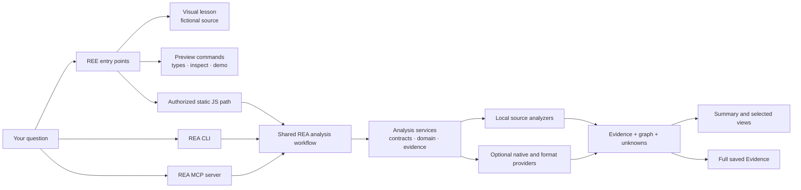
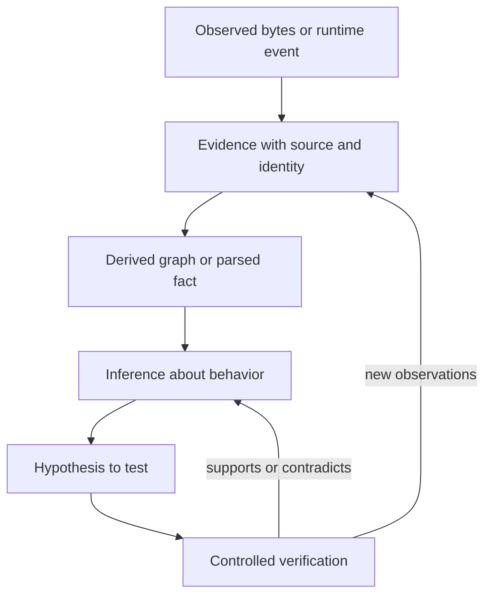

<div align="center">

# REE

### Reverse Engineering Everything

**Map the system. Follow the evidence. Verify what you learn.**

An approachable workbench for the [REA reverse engineering engine](https://github.com/morluto/rea).
REE keeps the original engine and adds a Mac friendly learning path, a cautious CLI front door, saved evidence views, and project guidance for AI agents.

[Start on a Mac](#start-on-a-mac) · [See how the tools fit together](#how-ree-and-rea-fit-together) · [Choose an analysis path](#choose-the-right-analysis-path) · [Use with Codex](#connect-codex) · [Read the upstream docs](UPSTREAM_REA_README.md)

</div>

---

## Start on a Mac

The fastest introduction is the local visual lesson. It uses a small, fictional code example and does not need an REA build or a provider installation.

```sh
node ree.mjs doctor       # read-only machine and toolchain check
node ree.mjs lab --open   # open the local visual lesson
```

The doctor output includes the overall REA Node engine check and stricter
runtime requirements for backends such as SQLite. A ready Node runtime does not
mean every provider is installed or available on the current host.

You can also open **`Start-REE.command`** from Finder. Keep its Terminal window open while the lesson runs; press Control+C to stop it. If macOS blocks the unsigned launcher, run `zsh ./Start-REE.command` from the checkout.

### Build the analyzer and run a real example

REE uses the repository's pinned Node and npm versions. The checkout currently pins Node 24.18.0 and npm 11.16.0. Supported engine ranges are Node 22.19+, 24.11+, and 26+; Node 23 and 25 are unsupported. SQLite inspection has a stricter native runtime requirement described in [its guide](docs/sqlite-databases.md).

```sh
git clone https://github.com/gryszzz/reverse-engineer-everything.git
cd reverse-engineer-everything

# If you use nvm and already installed the pinned version:
nvm use
npm ci
npm run build:cached

OUT="$(mktemp -d)/investigation"
node ree.mjs demo --run --out "$OUT"
cat "$OUT/REE_EVIDENCE_REPORT.md"
```

The demo analyzes only REE's own source controlled example with the real, locally built REA analyzer. It saves the complete `evidence.json` alongside `view-evidence.json`, `summary.json`, and a readable report. Output is outside the checkout so it does not mix with source or dependencies.

`doctor` only reports the current machine and local prerequisites. It does not install Node, native providers, or Codex settings. On an 8 GB Mac, keep one analysis running at a time and use bounded summaries before opening large evidence files.

## How REE and REA fit together

REE is the project identity and beginner workflow. **REA** is the inherited engine and MCP server name. This independent repository combines REE's approachable workflows with the REA engine; it does not claim authorship of the original REA providers.



The visual lesson is a teaching tool, not a live graph dashboard. `types`, `inspect`, and the default `demo` are previews. The real `demo --run` and `analyze` commands invoke the engine after the local build. The direct REA CLI and MCP expose a broader catalog than the simplified REE commands.

| Entry point                                        | What it does                                                 | Needs a build? |
| -------------------------------------------------- | ------------------------------------------------------------ | -------------- |
| `node ree.mjs lab --open`                          | Local beginner lesson served on loopback                     | No             |
| `node ree.mjs types`                               | Lists target families and their stated limits                | No             |
| `node ree.mjs inspect PATH`                        | Read-only classification and workflow preview                | No             |
| `node ree.mjs demo`                                | Previews the owned example                                   | No             |
| `node ree.mjs demo --run --out DIR`                | Runs real static analysis on the owned example               | Yes            |
| `node ree.mjs analyze PATH --authorized --out DIR` | Runs static JavaScript/Electron analysis on the named target | Yes            |
| `node scripts/rea.mjs --help`                      | Shows the full local REA CLI                                 | Yes            |
| Project MCP server `rea`                           | Exposes the REA tools to a connected agent                   | Yes            |

The `--authorized` flag is part of the REE static path. It does not authorize a different target or a runtime action. The full REA MCP server has its own broader tools and authority; review its tool descriptions and keep the requested target and actions in scope.

## Choose the right analysis path

The engine supports multiple formats, but the usable path depends on the artifact, operating system, installed provider, and analysis question. A recognized file type does not mean every optional tool is installed or every provider works on this Mac.

| Target or evidence                     | REA can help with                                                                      | Compatibility notes                                                                                                             |
| -------------------------------------- | -------------------------------------------------------------------------------------- | ------------------------------------------------------------------------------------------------------------------------------- |
| JavaScript and Electron source or ASAR | Module inventory, imports, application graph, source maps, feature traces, comparisons | Static analysis uses the local Node runtime. Runtime corroboration has separate browser/Electron requirements.                  |
| Native executable or library           | Metadata, disassembly, pseudocode, functions, references, control flow                 | Requires a compatible configured engine such as Ghidra, Hopper, or IDA. Provider and host support differ.                       |
| .NET PE/CLI assembly                   | Managed metadata, types, members, and CIL                                              | Metadata inspection is built in; NativeAOT code follows the native route.                                                       |
| Android APK                            | Manifest and code inspection                                                           | Uses Android specific prerequisites such as Java and JADX; see [Android analysis](docs/android-analysis.md).                    |
| Firmware image                         | Region inventory and optional extraction                                               | Uses caller supplied Binwalk/Unblob on supported Linux workflows; see [firmware analysis](docs/firmware-analysis.md).           |
| WebAssembly or EVM bytecode            | Offline artifact and interface inspection                                              | WABT or other format-specific requirements apply; output is evidence about the supplied bytes, not a live chain or application. |
| SQLite snapshot                        | Schema and selected row samples                                                        | Node 24.x at least 24.15 or Node 26+; preserve database and WAL identity.                                                       |
| HAR, SAZ, qlog, or packet capture      | Inspection of saved network records                                                    | Format and tool requirements vary. Reading a capture does not fetch URLs or perform live capture.                               |
| Go or Rust binary metadata             | Embedded build or dependency metadata when present                                     | A missing metadata section is unknown metadata, not proof the binary uses no dependencies.                                      |

For provider instructions, start from the [upstream documentation](UPSTREAM_REA_README.md) and the [advanced CLI guide](docs/cli.md). The [architecture diagram](docs/architecture.mermaid) and [testing guide](docs/testing.md) explain the underlying system and its validation approach.

## Follow evidence from overview to detail

An analysis can produce more information than is useful in a first response. Start with the summary, retain the full record, then open a focused view:

```sh
OUT="$(mktemp -d)/investigation"
node ree.mjs demo --run --out "$OUT"
node rel/evidence-explorer.mjs "$OUT/evidence.json" --find search.mjs
node rel/evidence-explorer.mjs "$OUT/evidence.json" --dot > "$OUT/relationships.dot"
```

The saved Evidence is the canonical analysis record. The summary is a compact projection; it does not replace or prove more than the underlying record. The local explorer displays a bounded set of canonical graph relationships, source locations, authority, and gaps. DOT output can be rendered with Graphviz if installed.

For an authorized JavaScript directory or ASAR, select a fresh output path outside both the target and this repository:

```sh
node ree.mjs inspect /absolute/path/to/my-app
node ree.mjs analyze /absolute/path/to/my-app \
  --authorized \
  --out /tmp/ree-investigation-001 \
  --question "How does the settings screen load and persist preferences?"
```

This path reads source and package files; it does not launch the supplied app. Exact source selections and limits are explicit in the engine workflow. **Selecting source paths does not automatically follow their imports.** Report unselected files, unresolved edges, parser failures, and other coverage limits as unknowns rather than treating them as absent behavior.

### Read conclusions with the right strength



- **Observed** means the bytes, fields, source range, or runtime event are present in the supplied evidence.
- **Derived** means REA parsed or related observations under a documented rule.
- **Inferred** means a conclusion follows from those observations but was not directly observed.
- **Unknown** includes unselected, unsupported, ambiguous, truncated, or unobserved cases.

A static import edge does not prove a module executed. A reconstruction is a new implementation to compare and test; reverse engineering does not guarantee recovery of original source or complete behavior.

## Connect Codex

Open this checkout in Codex and trust the project when prompted. Build the local runtime, then check the project configuration and server:

```sh
npm ci
npm run build:cached
node ree.mjs codex
codex mcp list
```

In the Codex session, check `/mcp` for the `rea` server. The project config is [`.codex/config.toml`](.codex/config.toml); it starts this checkout's `scripts/rea.mjs mcp`. Use the project workflow by calling `$ree-investigator` if available.

This connection is project scoped. It does not modify your account wide Codex configuration, train a model, or connect a cloud session to files on your Mac. The MCP server exposes the full REA tool set, not only REE's static JavaScript path. For host requirements and recovery steps, see [the Codex connection guide](rel/CONNECT_CODEX.md).

ChatGPT in a browser and Codex with this local checkout are separate environments. A GitHub connection can read the repository; it does not run the local MCP server or grant access to your Mac files.

## Compatibility and backend notes

- **Node:** package support is `^22.19.0 || ^24.11.0 || >=26.0.0`; this checkout's reproducible development version is 24.18.0.
- **npm:** use the lockfile and package manager version declared in `package.json` (`npm@11.16.0`) for repository installs.
- **Operating systems:** shared CLI and MCP workflows use platform-specific adapters. Linux, macOS, and Windows CI cover different paths; a pass on one runner does not certify all providers on every host.
- **Native engines:** Ghidra, IDA, Hopper, JADX, Binwalk/Unblob, WABT, Graphviz, and Wireshark are not one interchangeable backend. Each has its own version, host, licensing, configuration, and evidence boundary. REE does not silently install them.
- **Optional integrations:** provider discovery, package installation, and live attachment are distinct states. `doctor` reports selected readiness facts; it cannot prove a provider license, GUI state, or that another Codex session connected.

The latest checks are visible in [GitHub Actions](https://github.com/gryszzz/reverse-engineer-everything/actions). The Mac smoke workflow validates the Mac specific path; the full CI workflow includes Linux, Windows, package, provider, and compatibility lanes where their prerequisites are available.

## Repository map

| Path                                                                           | Responsibility                                                                                |
| ------------------------------------------------------------------------------ | --------------------------------------------------------------------------------------------- |
| [`ree.mjs`](ree.mjs)                                                           | REE preview, Mac checks, owned demo, and authorized static JavaScript front door              |
| [`rel/`](rel/)                                                                 | REE helpers: intake, static runner, Evidence Explorer, local lesson server, and Mac readiness |
| [`experiments/rel-visual-lab/`](experiments/rel-visual-lab/)                   | Browser based introductory lesson                                                             |
| [`experiments/rel-first-lab/`](experiments/rel-first-lab/)                     | Source owned analysis example and recorded verification                                       |
| [`scripts/rea.mjs`](scripts/rea.mjs)                                           | REA CLI and MCP dispatcher                                                                    |
| [`src/application/`](src/application/)                                         | Shared investigation and analysis workflows                                                   |
| [`src/domain/`](src/domain/)                                                   | Evidence models, graphs, comparisons, and domain rules                                        |
| [`src/composition/`](src/composition/)                                         | Provider selection and dependency wiring                                                      |
| [`src/contracts/`](src/contracts/)                                             | CLI/MCP input and output contracts                                                            |
| [`src/`](src/) providers, `bridge/`, `native/`                                 | Format specific adapters and native host boundaries                                           |
| [`.agents/skills/ree-investigator/`](.agents/skills/ree-investigator/SKILL.md) | REE project workflow for authorized investigations                                            |
| [`docs/architecture.mermaid`](docs/architecture.mermaid)                       | Detailed engine architecture                                                                  |
| [`UPSTREAM_REA_README.md`](UPSTREAM_REA_README.md)                             | Preserved upstream README and technical entry points                                          |

The folder names `rel/` and `experiments/rel-*` are retained implementation paths. REE is the current product name; REA remains the engine and MCP server identity. Existing `rel.mjs` and `Start-REL.command` shortcuts forward to the REE entry points.

## Contributing and attribution

Use the current default branch for new work. Start with the narrow check for the area you change, then consult [development testing](docs/testing.md) and [contribution guidance](CONTRIBUTING.md). Keep generated Evidence and local target data outside the source tree.

REE builds on [morluto/rea](https://github.com/morluto/rea) and is maintained independently. The original [MIT license](LICENSE), [third party notices](THIRD_PARTY_NOTICES.md), upstream technical guides, and archived README are retained. REE is not affiliated with the upstream project and does not publish as the upstream `rea-agents` npm package.
