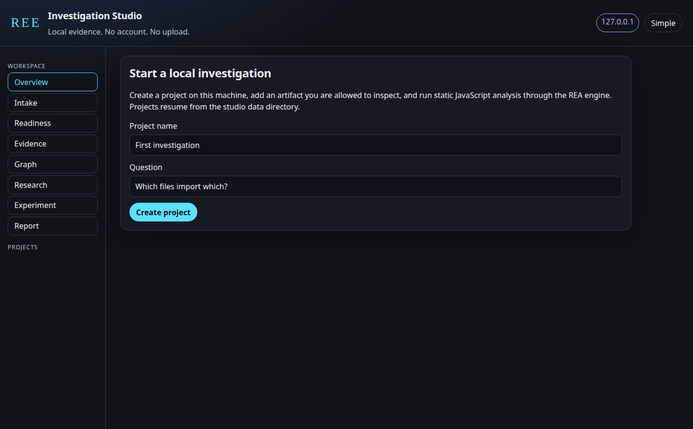
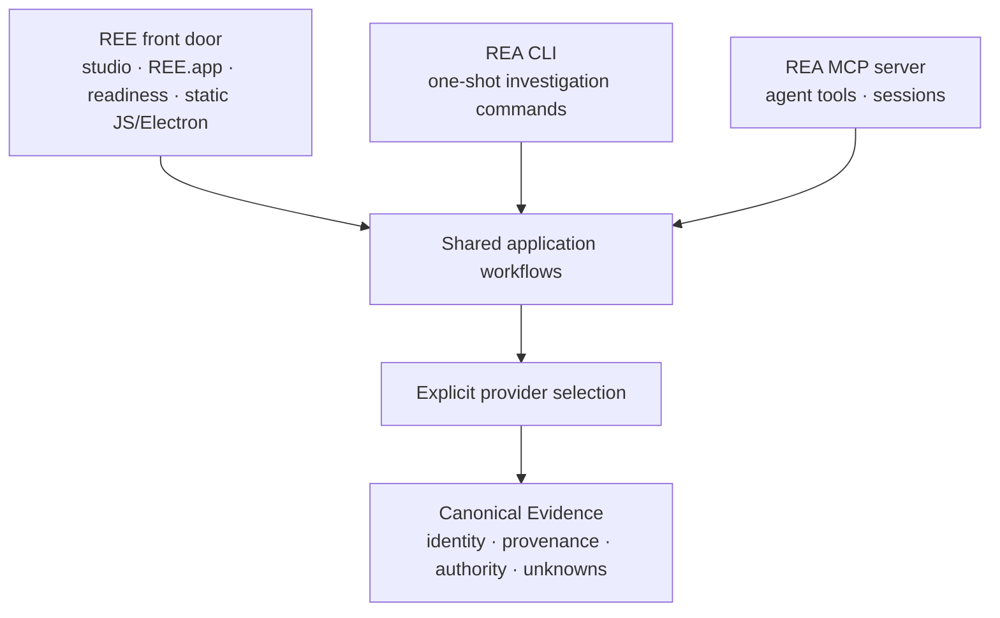

<div align="center">

# REE

### Reverse Engineering Everything

**Preserve the intelligence. Expand the possibilities.**

A local-first, Mac-first investigation studio on top of the REA analysis engine.
Projects, evidence, and experiments stay on your machine.

[](https://github.com/gryszzz/reverse-engineer-everything/actions/workflows/ci.yml)
[](https://github.com/gryszzz/reverse-engineer-everything/actions/workflows/rel-macos-smoke.yml)
[](.nvmrc)
[](LICENSE)

[Get started](#get-started) · [Studio](#investigation-studio) · [Support matrix](#support-matrix) · [Safety](#safety-and-authorization) · [CLI and MCP](#cli-and-mcp)


The picture is a live studio session in this checkout. It analyzed the owned fixture `experiments/rel-first-lab` and drew only relationships the engine stored. The selected edge is an inferred static relationship, not a captured execution.

</div>

## REE and REA

**REE** is this repository's product layer: the Investigation Studio, the beginner commands in `ree.mjs`, readiness checks, and the unsigned `REE.app` bundle. **REA** is the inherited analysis engine and MCP server from [morluto/rea](https://github.com/morluto/rea). REE does not replace that engine, and it is not published as the `rea-agents` npm package.

`npx rea-agents setup` installs upstream REA, not this checkout. The package name and MCP id remain `rea-agents` and `io.github.morluto/rea`. Release jobs stay gated to `morluto/rea`.

## What works today

| You can                                                                                | From                                                           |
| -------------------------------------------------------------------------------------- | -------------------------------------------------------------- |
| Create a project, resume it, classify an artifact, and read an honest readiness report | Studio, before a build                                         |
| Run static JavaScript/Electron analysis and browse the saved Evidence                  | Studio or `node ree.mjs analyze`, after `npm run build:cached` |
| Open a bounded graph of stored relationships and the recorded source line              | Studio                                                         |
| Compare two run summaries and export a Markdown report of saved records                | Studio                                                         |
| Approve one runtime probe of `experiments/rel-first-lab`                               | Studio Experiment                                              |
| Run the same static route and the owned demo from the terminal                         | `ree.mjs`                                                      |
| Use the full engine, including providers the studio does not launch                    | `node scripts/rea.mjs` and the project MCP server              |

The studio binds to `127.0.0.1` only. It has no account and does not upload Evidence. Research stages, when you turn them on, restate retained tool results. Remote model calls are refused.

## Investigation Studio

The studio is a loopback page served from this checkout. Simple Mode is plain language. Advanced Mode adds Evidence ids, readiness fields, and the exact analyzer command.

These shots are from one live session against `experiments/rel-first-lab` after an authorized static run. The Evidence id in the pictures is `ev_45d365f3b6f0be5b8831504b9bf5f268826bf0973e47a11ad01e1bd65587d58b`. That run recorded 49 graph nodes and 67 edges. Nothing in the pictures was drawn in by hand.

### Welcome



### Overview


### Intake


Classification reads a directory listing or the first bytes of a file. It does not analyze or launch the target. The authorization checkbox is required before analysis, and that run reads source. It does not start the fixture.

### Readiness


`recorded-in-this-studio` means a completed action in this data directory. It is not a CI result and not a statement about another Mac. A command on `PATH` is not treated as configured or verified. The full route list is the [support matrix](#support-matrix).

### Evidence


Search uses the saved application graph. A hit is a recorded relationship, not proof that the code ran.

### Graph

The graph at the top of this page is the same session, filtered to `cli.mjs`, with the recorded source line open. The window copies stored edges. It does not invent nodes for files that were not in that window. Positions are display-only. There is no separate trace of a live execution in this view.

### Experiment


The preview is the exact command. Nothing runs until the approved digest matches. This capture returned `N-102`, `N-101`, `N-104`. The caller-declared title-weighted prediction matched. The tag-first prediction did not. The finite-hypothesis planner, asked with no Evidence observations, reported `insufficient-evidence`. The capture is not written into `evidence.json` and is not sent back to the planner, because this studio does not mint Evidence ids.

### Research


Local stages are off until you enable them. They restate intake, Evidence, and saved comparisons. A key in the research config is not shown and is not sent.

### Report


The report restates saved records. It does not add findings. Hyphens in the Markdown are escaped, so a path can show a backslash before a hyphen. That is the exporter, not a second analysis.

## Get started

> **Distribution:** these steps run this checkout. They do not publish REE and they do not install upstream `rea-agents`.

Clone the repository and use the pinned toolchain when you want the analyzer: **Node 24.18.0** and **npm 11.16.0**. `nvm use` selects that Node version. `doctor` and an empty studio also run on other Node versions inside the engine range `^22.19.0 || ^24.11.0 || >=26.0.0`.

### Mac app

From the checkout:

```sh
git clone https://github.com/gryszzz/reverse-engineer-everything.git
cd reverse-engineer-everything
nvm use
node ree.mjs doctor
npm ci
npm run build:cached
node ree.mjs app build
node ree.mjs app install
```

Then open **REE** from `~/Applications` or the Desktop link. Install asks Finder for an alias and kills that request if it has not finished in five seconds, then leaves a symlink. The build records this checkout and the Node binary you used. Rebuild after either one moves.

`node ree.mjs app build` compiles the WebKit window with `swiftc`. It uses `swiftc` on `PATH` when that runs, and otherwise `xcrun -f swiftc` and `xcrun --sdk macosx -f swiftc`, including `/usr/bin/xcrun` when the Command Line Tools compiler is not on `PATH`. It sets `SDKROOT` from `xcrun --sdk macosx --show-sdk-path` and passes that SDK to `swiftc`, because a compiler on `PATH` can still fail to load the standard library for `arm64-apple-macos12.0` without it. It tries an Apple Silicon slice and an Intel slice and combines them when both compile. A failed build deletes the partial `REE.app` it just created. The bundle id is `io.github.gryszzz.ree.studio`, the display name is **REE**, and the icon is the graphite mark in `rel/app/mac/AppIcon.svg`.

The bundle is unsigned and not notarized. If macOS says it cannot be opened, right-click `REE.app`, choose **Open**, then **Open**. That leaves Gatekeeper on. Closing the window stops the studio. A second launch focuses the running app. If Node.js cannot be found, the app shows an alert instead of a blank window.

`Start-REE-Studio.command` and `node ree.mjs studio --open` open the same page in your browser and leave a Terminal window running. `Start-REE.command` is the separate visual lesson, not the studio.

Details: [Investigation Studio](docs/investigation-studio.md) and [Mac setup](rel/MAC_SETUP.md).

### Terminal

```sh
nvm use
node ree.mjs doctor
node ree.mjs studio --open
```

Projects are stored in `~/Library/Application Support/REE/studio` unless you pass `--data DIR`. That directory must sit outside the checkout. The page is only `http://127.0.0.1:<port>/`.

Build, then analyze the owned example. The demo command is the source-owned lab:

```sh
npm ci
npm run build:cached

OUT="$(mktemp -d)/ree-demo"
node ree.mjs demo --run --out "$OUT"
```

In the studio: create a project, choose **Use the owned JavaScript fixture**, check the authorization box, and run static analysis. Open Evidence and search `cli.mjs` or `search.mjs`. Open Graph and select an inferred edge.

For a JavaScript or Electron tree you are allowed to inspect:

```sh
node ree.mjs inspect /absolute/path/to/app

OUT="$(mktemp -d)/ree-investigation"
node ree.mjs analyze /absolute/path/to/app \
  --authorized \
  --out "$OUT" \
  --question "Which files import which?"
```

`inspect` classifies. `analyze` parses source. It does not launch the target. Choose a new output directory outside both the target and this checkout. The question is kept in the REE report. It is not a new engine argument.

Saved files are `evidence.json`, `summary.json`, `view-evidence.json`, and `REE_EVIDENCE_REPORT.md`. Browse them with [Evidence Explorer](rel/EVIDENCE_EXPLORER.md):

```sh
node rel/evidence-explorer.mjs "$OUT/evidence.json" --find cli.mjs --limit 12
```

## Support matrix

Status words mean only this:

| Word                    | Meaning                                                                                                  |
| ----------------------- | -------------------------------------------------------------------------------------------------------- |
| **Implemented**         | This checkout runs it, including from the studio or `ree.mjs`.                                           |
| **Experimental**        | A bounded path with an explicit limit.                                                                   |
| **Needs external tool** | The engine has the route. You supply the tool and use the REA CLI or MCP. The studio does not launch it. |
| **Unsupported**         | The studio refuses it, or it has no such action.                                                         |

| Route                                                          | Engine              | Studio                                 | Status                  |
| -------------------------------------------------------------- | ------------------- | -------------------------------------- | ----------------------- |
| JavaScript / Electron static analysis                          | Implemented         | Runs it after a local build            | **Implemented**         |
| Evidence search and bounded relationship graph                 | Implemented         | Uses saved Evidence                    | **Implemented**         |
| Project save / resume, intake, readiness, report, summary diff | REE product         | Implemented                            | **Implemented**         |
| Owned `experiments/rel-first-lab` probe                        | Not an engine route | One approved command, query `bridge`   | **Experimental**        |
| Finite hypothesis planner                                      | Implemented         | Preview with no observations           | **Experimental**        |
| Local research stages                                          | Not an engine route | Off by default; restates saved results | **Experimental**        |
| Remote model commentary                                        | None                | Refused, even if a key is stored       | **Unsupported**         |
| SQLite snapshots                                               | Implemented         | Not invoked                            | **Needs external tool** |
| Ghidra, IDA, Hopper                                            | Implemented         | Not invoked                            | **Needs external tool** |
| JADX, Apktool, JEB                                             | Implemented         | Not invoked                            | **Needs external tool** |
| Firmware, WebAssembly, packet capture                          | Implemented         | Not invoked                            | **Needs external tool** |
| Browser / Electron runtime observation                         | Implemented         | Not invoked                            | **Needs external tool** |
| REA process capture                                            | Implemented         | Not invoked                            | **Unsupported**         |

SQLite inspection wants Node 24.15+ or 26+. A missing `ghidra` or `hopper` command does not prove the Mac app is absent, and a command on `PATH` does not prove a decompilation. Process capture is an engine workflow with its own host and authority rules. The studio experiment does not call it.

Guides for the engine routes stay in the [upstream README](UPSTREAM_REA_README.md) and the [documentation index](docs/index.md): [JavaScript](docs/javascript-application-workflows.md), [native](docs/native-investigation.md), [Android](docs/android-analysis.md), [firmware](docs/firmware-analysis.md), [WebAssembly](docs/wasm-artifacts.md), [SQLite](docs/sqlite-databases.md), [browser](docs/browser-observation.md), [packets](docs/pcap-analysis.md), [process capture](docs/process-capture.md).

Native example, when you already have a provider:

```sh
node scripts/rea.mjs inspect /absolute/path/to/program --provider ghidra --json
```

REE does not silently substitute one native engine for another.

## Safety and authorization

- The studio and `REE.app` listen on `127.0.0.1` only. Other hosts and other origins are refused. There is no account and no upload.
- Static analysis starts only after you set authorization. The child process is the public `node ree.mjs analyze --authorized` command. One run at a time, three-minute timeout, then SIGTERM and SIGKILL.
- The owned probe lists its argv, timeout, and file hashes. A digest mismatch is rejected. `approved` must be boolean true. Any other directory is refused. Analysis authorization does not approve the probe.
- Runtime capture stays on the experiment record. It is not merged into static Evidence.
- Research does not call a model. A configured key is not returned to the page and is not sent.
- Child analysis environments are an allowlist. The ambient environment is not saved as evidence.
- The app does not install Node, Homebrew, Ghidra, IDA, Hopper, or anything else. If Node is missing, it stops with an explanation.

## CLI and MCP

Beginner REE commands:

| Command                                              | What it does                                      |
| ---------------------------------------------------- | ------------------------------------------------- |
| `node ree.mjs doctor`                                | Read-only host and toolchain report               |
| `node ree.mjs inspect TARGET`                        | Classify. Do not analyze                          |
| `node ree.mjs analyze TARGET --authorized --out DIR` | Static JavaScript / Electron                      |
| `node ree.mjs demo`                                  | Preview the owned lab                             |
| `node ree.mjs demo --run --out DIR`                  | Analyze the owned lab and run its checks          |
| `node ree.mjs studio`                                | Loopback Investigation Studio                     |
| `node ree.mjs app build`                             | Build unsigned `REE.app` on macOS                 |
| `node ree.mjs app install`                           | Copy it to `~/Applications` and alias the Desktop |
| `node ree.mjs lab`                                   | Visual lesson, separate from the studio           |
| `node ree.mjs codex`                                 | Check this checkout's Codex project files         |

The engine commands and MCP tools are unchanged. Representative pairs:

| Task                                  | CLI                              | MCP                              |
| ------------------------------------- | -------------------------------- | -------------------------------- |
| Inspect an analysis view              | `inspect-analysis-view`          | `inspect_analysis_view`          |
| Trace an application feature          | `trace-application-feature`      | `trace_application_feature`      |
| Compare application versions          | `compare-application-versions`   | `compare_application_versions`   |
| Capture a process scenario            | `capture-process`                | `capture_process_scenario`       |
| Select a finite hypothesis probe      | `discriminate-finite-hypotheses` | `discriminate_finite_hypotheses` |
| Verify selected reconstruction claims | `verify-reconstruction`          | `verify_reconstruction`          |

```sh
node scripts/rea.mjs --help
node ree.mjs codex
```

Contracts: [CLI](docs/cli.md), [MCP](docs/mcp-contracts.md). Codex setup for this checkout: [rel/CONNECT_CODEX.md](rel/CONNECT_CODEX.md). `node ree.mjs codex` checks local files. It does not prove a live MCP session. The MCP server has more authority than the beginner static command. Keep the target and the permitted actions explicit.

The finite planner ranks caller-supplied predictions. It does not invent hypotheses or launch a target. The owned C fixture under `experiments/ree-investigation-boundary/` is a separate bounded experiment and wants macOS, Clang, and a built runtime: `npm run verify:ree-investigation-boundary -- /tmp/ree-c-investigation`. A counterexample there refutes that candidate for the chosen case. It is not a general equivalence certificate. See [reconstruction reports](docs/reconstruction-reports.md).

## Limitations

- There is no separate published REE package, updater, or notarized app.
- The studio does not launch Ghidra, IDA, Hopper, JADX, Apktool, JEB, firmware tools, browser debuggers, packet capture, SQLite, or `capture-process`.
- A static graph edge is not an observed execution.
- The probe cannot target anything except `experiments/rel-first-lab`, and the command it runs is the `bridge` query.
- Research has no model cost because no model is called.
- Evidence browsing stops at the existing 64 MiB explorer limit. The graph window is at most 200 application edges, or 40 semantic relations.
- Source excerpts open only when the recorded path stays inside a directory target.
- `REE.app` points at the checkout path saved when you built it. Moving the repo without rebuilding breaks the app until you build again.
- Force-quit can leave the server process. The next launch stops a recorded leftover server, then starts a new one.
- These studio pictures were captured from the live page over loopback. They are not a substitute for a provider run you have not done.

## Architecture



| Layer                              | Source                                                                                       |
| ---------------------------------- | -------------------------------------------------------------------------------------------- |
| REE entry, studio, app bundle      | [`ree.mjs`](ree.mjs), [`rel/`](rel/), [`Start-REE-Studio.command`](Start-REE-Studio.command) |
| REA workflows, providers, Evidence | [`src/`](src/), [`scripts/rea.mjs`](scripts/rea.mjs), [`bridge/`](bridge/)                   |
| Owned JavaScript fixture           | [`experiments/rel-first-lab/`](experiments/rel-first-lab/)                                   |

The map is the system, not one command that analyzes every file type. See the [engineering map](docs/ree-engineering-map.md) and [product readiness notes](docs/ree-product-readiness.md).

| Interpretation | What it means                                                |
| -------------- | ------------------------------------------------------------ |
| **Observed**   | Present in the supplied artifact or captured event           |
| **Derived**    | Produced by a parser or an explicit rule                     |
| **Inferred**   | Supported by observations, with the inference boundary kept  |
| **Unknown**    | Unselected, unsupported, ambiguous, truncated, or unobserved |

Static reachability does not prove execution. A missing match does not prove a behavior is absent.

## License and attribution

REE builds on **[morluto/rea](https://github.com/morluto/rea)**. The inherited engine, providers, technical guides, [upstream README](UPSTREAM_REA_README.md), [MIT license](LICENSE), and [third-party notices](THIRD_PARTY_NOTICES.md) are preserved. This repository does not claim authorship of that foundation.

Contributions should preserve provider boundaries, Evidence provenance, platform workflows, and that attribution. See [CONTRIBUTING.md](CONTRIBUTING.md).
