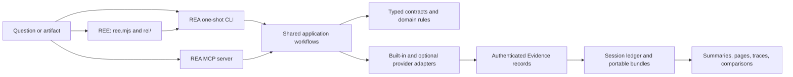

# REE and REA: source-verified engineering map

This guide records how the checkout works today, based on source inspection,
its tests and safe local execution. It separates the REE front door from the
inherited REA engine and calls out the areas this pass did not verify.

## System in one view

REE is the product and onboarding layer. The executable `ree.mjs` offers a
Mac-first readiness check, a preview-only intake, a local teaching lab, and a
guarded static JavaScript/Electron analysis path. The analysis engine is REA:
the TypeScript package behind the `rea` CLI and the `rea` MCP server. REE's
authorized analysis command delegates to that local engine and presents its
Evidence; it does not implement a second analyzer.

The broad design is ports and adapters around an Evidence-centered domain:

The detailed inherited component diagram remains in
[`architecture.mermaid`](architecture.mermaid). This guide adds the execution
paths, fork state and limits needed to read that diagram accurately.

## REE front door: what runs

The public beginner commands are implemented in [`ree.mjs`](../ree.mjs):

| Command                               | Source path                                       | Verified behavior                                                          |
| ------------------------------------- | ------------------------------------------------- | -------------------------------------------------------------------------- |
| `doctor [--json]`                     | `rel/mac-doctor.mjs`                              | Reads host/toolchain state; does not run REA or install software.          |
| `types`                               | `rel/intake.mjs`                                  | Lists target families and their declared prerequisites.                    |
| `inspect PATH`                        | `rel/intake.mjs`                                  | Classifies a supplied path and prints a plan; it does not analyze it.      |
| `lab [--open]`                        | `rel/lab-server.mjs`                              | Serves a source-owned visual lesson on loopback.                           |
| `demo`                                | `rel/intake.mjs`                                  | Previews the source-owned fixture.                                         |
| `demo --run --out DIR`                | `experiments/rel-first-lab/run-real-analysis.mjs` | Runs static analysis on the repository's own lesson fixture.               |
| `analyze PATH --authorized --out DIR` | `rel/analyze-static.mjs`                          | Runs static JavaScript/Electron analysis on an admitted directory or ASAR. |

`inspect` is an intake heuristic: for directories it looks only at directly
visible entries such as `package.json` or source files; it does not recursively
identify a complete project or prove the format. `types` is a catalog, not a
claim that every listed provider is installed. The `--authorized` flag is
specific to this constrained REE static path. It does not authorize running a
target or grant a direct REA CLI/MCP tool new authority.

The static analysis admission path in `rel/analyze-static.mjs` checks the
explicit authorization, supported input type, resolved target path, a fresh
output directory outside both the repository and target, and the presence of
the built local REA CLI. It then starts the local `scripts/rea.mjs` child with
`analyze-javascript-application --summary --evidence-out ... --json`. It saves
the compact view, complete parent Evidence, a summary and a readable report.
The target application is parsed as data; REE does not launch it. The report
explicitly distinguishes static relationships from observed execution.

The local visual lab is a teaching surface. Its tests check loopback binding,
allowlisted local files, and the lesson's actual ranking logic. It is not a
live analyzer dashboard.

## REA process entry points

### One-shot CLI

[`scripts/rea.mjs`](../scripts/rea.mjs) is the executable boundary. It routes
`rea mcp`/`rea --mcp` directly to the compiled server before loading the CLI
framework; ordinary commands load the compiled runtime after checking the
required build files. This keeps the long-lived MCP server from being treated
as a normal one-shot command.

[`src/cli.ts`](../src/cli.ts) constructs an Incur CLI, snapshots the selected
environment, creates direct-analysis dependencies and registers command groups
for artifacts, JavaScript, native analysis, Android, firmware, captures,
databases, application workflows, Evidence, and setup. Command registration is
adapter code. Core operations are implemented by application services and
domain modules.

[`src/composition/directAnalysis.ts`](../src/composition/directAnalysis.ts)
binds one-shot analysis to a stable environment snapshot and loads the binary
session composition only when that operation needs it. This supports commands
that do not need to initialize a heavyweight native provider.

### Long-lived MCP server

[`src/main.ts`](../src/main.ts) parses configuration, creates one binary
session, opens an optional initial target, starts stdio transport, loads
optional observation providers, and installs idempotent shutdown handlers.
EOF, SIGINT and SIGTERM lead through the shared shutdown boundary. Unexpected
startup errors are intentionally projected to a generic caller-facing error.

[`src/server/`](../src/server/) translates MCP calls into typed contracts and
application services. Tool registration is split by capability family; the
server owns transport delivery, tool availability, progress, result encoding
and retained session records. CLI and MCP are separate adapters over shared
behavior, although a few adapters also expose interface-specific utilities.

## Application, provider and process boundaries

### Shared application workflows

[`src/application/`](../src/application/) owns orchestration and narrow ports
to providers, Evidence storage and operating-system boundaries. Examples:

- `DirectAnalysis.ts` routes direct operations into a session/client and
  ensures lifecycle cleanup.
- `javascript/JavaScriptApplicationWorkflowService.ts` validates Evidence
  identities before deriving feature traces, version comparisons,
  source-to-bundle comparisons and export-shape comparisons.
- `analysisView/AnalysisViewService.ts` projects summaries and selected views
  from retained or caller-provided parent Evidence. A selected view links back
  to its parent; it is not a replacement source of truth.
- `investigation/EvidenceLedger.ts` deduplicates immutable records, rejects
  conflicting identities and atomically imports/exports validated bundles.
- `ReconstructionObligationLedgerService.ts` records explicit reconstruction
  claims and linked evidence. Reconstruction readiness helpers check whether
  evidence satisfies defined obligations; they do not prove universal
  behavioral equivalence.

This is where the existing system already connects analysis to explanation and
reconstruction. Feature tracing can correlate static application graph
relationships with supplied native/runtime observations. Version and
source-to-bundle comparison consume prior Evidence instead of rerunning a
provider implicitly.

### Provider selection

[`src/composition/binary.ts`](../src/composition/binary.ts) is the production
composition point for target-switching analysis. It creates Hopper, Ghidra and
IDA candidates for deep native analysis, then registers auxiliary providers
separately. `AnalysisProviderRegistry` discovers candidates and resolves one
deep provider binding for a target. The selection is deterministic and does
not silently fall through to a different disassembler after a selected provider
fails. `SessionProviderRouter` enforces disjoint operation ownership between
the deep provider and auxiliary providers.

This boundary matters because provider declarations, discoverability, target
compatibility, session binding and actual successful execution are different
facts. A catalog entry or a passing fake-provider test does not establish that
a particular Ghidra/Hopper/IDA installation works on this Mac.

Provider families under `src/` include JavaScript/ASAR, native Ghidra/Hopper/
IDA, managed .NET metadata, Android/APK tooling, Apple artifacts, firmware,
WASM, EVM, Go/Rust metadata, SQLite, browser/Electron observation, recorded
network and signal captures, process capture, GDB/Rizin, and binary layout
inspection. The matching provider code and focused guide determine each
workflow's host and side-effect boundary.

### Domain, contracts and Evidence

[`src/domain/`](../src/domain/) holds provider-neutral schemas and semantics;
[`src/contracts/`](../src/contracts/) holds caller-facing input/output
contracts. The `Result` error algebra and strict schemas keep malformed input,
expected failures and partial evidence explicit. The architecture rules in
[`AGENTS.md`](../AGENTS.md) require dependencies to flow inward and keep
provider-specific protocol details out of domain/application code.

[`src/domain/evidence.ts`](../src/domain/evidence.ts) defines the shared
Evidence envelope: semantic ID, artifact subject and digest, provider and
analysis profile, operation and parameters, raw and normalized result,
confidence (`observed`, `derived`, `inferred`), authority, environment,
limitations, relationship coverage, source locations and links to other
Evidence. The ID is recomputed from semantic content. Display paths are
separated from artifact identity. Evidence is the durable boundary between
tools, views, comparisons and portable bundles.

[`src/domain/evidenceBundle.ts`](../src/domain/evidenceBundle.ts) validates a
portable collection of records and manifests. Residual unknowns have their own
revision and mutation-evidence model. Session retention lives in
`src/application/investigation/`; MCP adapters receive narrow record/query
ports rather than owning alternate Evidence semantics.

### Process and host safety

[`src/process/`](../src/process/) supplies process supervision, bounded
execution, private temporary roots, diagnostics and cleanup primitives used by
provider adapters. `src/windows/` and `native/windows/` own Windows-specific
process/package boundaries. Browser, debugger, runtime-observation, extraction
and target execution paths have distinct contracts; they are not implied by a
static analysis request. See the tool-specific guides before using any live or
external boundary.

## Build, dependencies and tests

This is a single npm package at the repository root, not a workspace
monorepo. `package.json` still identifies it as `rea-agents` version `6.4.0`,
with CLI names `rea` and `rea-agents`, MCP name `io.github.morluto/rea`, and
repository/homepage pointing to `morluto/rea`. Those are inherited package
identities; the GitHub repository is now `gryszzz/reverse-engineer-everything`.
The source fork has not yet established its own distributable package identity.

The checkout pins Node `24.18.0` in `.nvmrc` and npm `11.16.0` in
`packageManager`. The declared engine range is Node `^22.19.0 || ^24.11.0 ||

> =26.0.0`; SQLite requires Node `24.15+`or`26+`. `npm ci`installs the
> lockfile-defined graph. TypeScript is compiled using`tsconfig.build.json`,
> then `scripts/bundle-runtime.mjs`produces CLI/MCP runtime artifacts. Turborepo
> coordinates cached build, test preparation, static checks and generated
> metadata. Native providers and tools such as Ghidra, Hopper, JADX, WABT,
> Binwalk, TShark and sigrok have separate prerequisites and are not all npm
> dependencies.`frida`is optional.`third_party/` contains pinned or documented
> vendored integrations and submodules.

Vitest projects are divided by proof boundary: domain, services, adapters,
composition, filesystem/process/CLI/MCP boundaries, acceptance, conformance,
evaluation and process-global behavior. The project settings are in
[`vitest.config.ts`](../vitest.config.ts), selection logic in
`scripts/lib/test-projects.mjs`, and the rationale in
[`docs/testing.md`](testing.md). CI adds five coverage shards, reverse-tool
mutation checks, source-built conformance, target-specific provider lanes,
macOS/Windows package verification, and real-browser/artifact workflows when
the change classifier selects them. A unit or simulated-provider test and a
real-provider lane prove different things.

### Package and release boundary

The release workflow `.github/workflows/release.yml` intentionally gates
release preparation and publication on `github.repository == 'morluto/rea'`.
It targets the inherited `rea-agents` npm package and upstream MCP registry
identity. On this fork those release jobs are disabled. This is protective,
but it also means that building the project locally or passing CI does not
produce an installable REE package. Any future release plan first needs a
deliberate package name, MCP identity, ownership of registry credentials and
reviewed release workflow. No such change is made in this phase.

## Repository and history state

At inspection time, the configured remote was
`https://github.com/gryszzz/reverse-engineer-everything.git`; GitHub reported a
public, independent repository (`isFork: false`, no parent), with `main` as its
default and no open pull requests. The local `main` tracks `origin/main`.
GitHub `main` begins with the parentless `3a97a5a` standalone snapshot, followed
by the current fix. Thus the source tree is present in the new repository, but
its earlier Git ancestry is not reachable from remote `main`.

The local branch `archive/pre-standalone-rel-foundations` preserves the prior
branch history, including the earlier REL/REE integration and merge history.
It is a local recovery branch, not a remote collaboration branch. There are no
local tags in this checkout. Comparing the current tree to that archived tip
shows the latest standalone branding/runtime-doc adjustments and the doctor
runtime-compatibility refinement; it does not represent the complete list of
all earlier fork changes against upstream.

## Verification performed for this map

Safe local commands on this Mac returned:

- `node ree.mjs types --json`: the target-family catalog was emitted.
- `node ree.mjs inspect . --json`: the checkout was classified as a JavaScript
  directory from its visible `package.json`; this is preview classification,
  not an REA source audit.
- `node --test rel/*.test.mjs`: **51 passed**. This includes the REE command
  admission/report tests, a compiled local REA static-analysis fixture test,
  an MCP tool-discovery handshake, Evidence Explorer tests, intake tests and
  doctor boundary tests.
- The GitHub run for commit `8dbe93d` had successful REE macOS smoke and
  first-real-analysis workflows. The broader CI run was still in progress at
  the last check; the full qualification is not claimed green here.

The current local doctor reported macOS arm64, 8 GiB RAM, Node `22.18.0`,
npm `10.9.3`, and the already-present build/dependencies. Node `22.18.0` is
below the declared minimum `22.19.0` and differs from the pinned Node/npm
versions. The doctor therefore marked both the engine and SQLite runtime
unsupported and reported only 0.1 GiB currently free. This is a meaningful
local readiness constraint: the focused Node tests passed, but they do not
make this runtime supported or prove a fresh build/provider works. I did not
start a fresh build under this unsupported, low-memory runtime.

## Established strengths and unresolved scope

### Verified strengths

- REE's beginner path distinguishes preview, static analysis and provider-led
  workflows; static output is saved with provenance and limitations.
- CLI and MCP share core application/domain semantics and use separate
  adapters.
- Evidence identity, provider identity, artifact identity, confidence,
  authority and coverage are modeled explicitly rather than inferred from a
  rendered report.
- Existing views, traces, version comparisons, static/runtime correlation,
  reconstruction coverage and obligation ledgers already form useful
  multi-step investigation building blocks.
- Provider selection, process ownership and cleanup are explicit architectural
  boundaries with broad focused test projects.

### Not established by this pass

- Availability, licensing or real operation of Hopper, Ghidra, IDA, JADX,
  firmware tools, browser runtimes, Android tools or hardware on this machine.
- Full cross-platform behavior or a green full CI matrix for the latest commit.
- A clean install/build using the pinned Node/npm versions in this checkout.
- Complete comparison of every fork commit against upstream. Remote `main` is
  a parentless snapshot; the detailed prior history is only available on the
  local archive branch.
- That every declared file format has a working end-to-end route. Intake labels
  and provider catalogs alone do not establish operational support.

### Natural evolution opportunities (not implementation plans)

1. **Investigation graph across existing operations.** The services already
   consume linked Evidence for static graphs, runtime observations, version
   differences and reconstruction checks. A guided workflow could join these
   operations while preserving the exact parent IDs, provenance and unknowns.
   Test it with one analyst question and measure whether it yields a clearer
   verified result than manually chaining tools.
2. **Provider readiness as evidence.** The current layers distinguish candidate
   discovery from selection and execution. A structured readiness report could
   clarify which part is missing for a selected workflow without claiming an
   unexecuted provider works.
3. **Large Evidence navigation.** Summaries and pages already project from
   retained canonical Evidence. The REE explorer still has full-record size
   limits; measure storage and lookup behavior before designing random-access
   indexes or another duplicate evidence format.
4. **Identity and release ownership.** Decide whether REE remains a source
   checkout that builds the compatible `rea-agents` engine or becomes a
   separately distributable product. The current upstream package and MCP
   identities make this a release/compatibility decision, not a README rename.
5. **History continuity.** Decide how future maintainers should access the
   upstream/fork ancestry now that remote `main` begins at a standalone
   snapshot. The local archive protects this workstation but is not a shared
   backup.

These opportunities follow from current code and repository state. They are
questions for later design work, not shipped features or authorization to alter
release, provider or repository settings.
