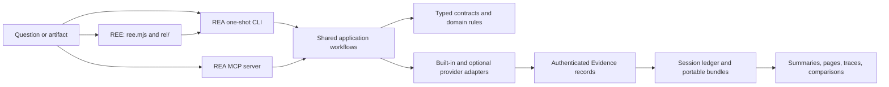

# REE and REA: source-verified engineering map

This guide records how the checkout works today, based on source inspection,
its tests and safe local execution. It separates the REE front door from the
inherited REA engine and calls out the areas this pass did not verify.

## System in one view

REE is the product and onboarding layer. The executable `ree.mjs` offers a
Mac-first readiness check, a preview-only intake, a local teaching lab, a
guarded static JavaScript/Electron analysis path, and an opt-in public-document
collector (`outside-in`). The analysis engine is REA: the TypeScript package
behind the `rea` CLI and the `rea` MCP server. REE's authorized static analysis
command delegates to that local engine and presents its Evidence. `outside-in`
does not call the engine and does not analyze target source.

The broad design is ports and adapters around an Evidence-centered domain:

The detailed inherited component diagram remains in
[`architecture.mermaid`](architecture.mermaid). This guide adds the execution
paths, fork state and limits needed to read that diagram accurately.

## REE front door: what runs

The public beginner commands are implemented in [`ree.mjs`](../ree.mjs):

| Command                               | Source path                                       | Verified behavior                                                             |
| ------------------------------------- | ------------------------------------------------- | ----------------------------------------------------------------------------- |
| `doctor [--json]`                     | `rel/mac-doctor.mjs`                              | Reads host/toolchain state; does not run REA or install software.             |
| `types`                               | `rel/intake.mjs`                                  | Lists target families and their declared prerequisites.                       |
| `inspect PATH`                        | `rel/intake.mjs`                                  | Classifies a supplied path and prints a plan; it does not analyze it.         |
| `lab [--open]`                        | `rel/lab-server.mjs`                              | Serves a source-owned visual lesson on loopback.                              |
| `demo`                                | `rel/intake.mjs`                                  | Previews the source-owned fixture.                                            |
| `demo --run --out DIR`                | `experiments/rel-first-lab/run-real-analysis.mjs` | Runs static analysis on the repository's own lesson fixture.                  |
| `analyze PATH --authorized --out DIR` | `rel/analyze-static.mjs`                          | Runs static JavaScript/Electron analysis on an admitted directory or ASAR.    |
| `outside-in`                          | `rel/outside-in/`                                 | Opt-in public-document behavior spec. No target source, login, or model call. |

`inspect` is an intake heuristic: for directories it looks only at directly
visible entries such as `package.json` or source files; it does not recursively
identify a complete project or prove the format. `types` is a catalog, not a
claim that every listed provider is installed. The `--authorized` flag is
specific to this constrained REE static path. It does not authorize running a
target or grant a direct REA CLI/MCP tool new authority. `outside-in` does not
use that flag. It fetches only caller-named public documents.

The static analysis admission path in `rel/analyze-static.mjs` checks the
explicit authorization, supported input type, resolved target path, a fresh
output directory outside both the repository and target, and the presence of
the built local REA CLI. It then starts the local `scripts/rea.mjs` child with
`analyze-javascript-application --summary --evidence-out ... --json`. It saves
the compact view, complete parent Evidence, a summary and a readable report.
The target application is parsed as data; REE does not launch it. The report
explicitly distinguishes static relationships from observed execution.

The local visual lab is a teaching surface. Its tests check loopback binding,
allowlisted local files, and the lesson's actual ranking logic. It is not a
live analyzer dashboard.

## REA process entry points

### One-shot CLI

[`scripts/rea.mjs`](../scripts/rea.mjs) is the executable boundary. It routes
`rea mcp`/`rea --mcp` directly to the compiled server before loading the CLI
framework; ordinary commands load the compiled runtime after checking the
required build files. This keeps the long-lived MCP server from being treated
as a normal one-shot command.

[`src/cli.ts`](../src/cli.ts) constructs an Incur CLI, snapshots the selected
environment, creates direct-analysis dependencies and registers command groups
for artifacts, JavaScript, native analysis, Android, firmware, captures,
databases, application workflows, Evidence, and setup. Command registration is
adapter code. Core operations are implemented by application services and
domain modules.

[`src/composition/directAnalysis.ts`](../src/composition/directAnalysis.ts)
binds one-shot analysis to a stable environment snapshot and loads the binary
session composition only when that operation needs it. This supports commands
that do not need to initialize a heavyweight native provider.

### Long-lived MCP server

[`src/main.ts`](../src/main.ts) parses configuration, creates one binary
session, opens an optional initial target, starts stdio transport, loads
optional observation providers, and installs idempotent shutdown handlers.
EOF, SIGINT and SIGTERM lead through the shared shutdown boundary. Unexpected
startup errors are intentionally projected to a generic caller-facing error.

[`src/server/`](../src/server/) translates MCP calls into typed contracts and
application services. Tool registration is split by capability family; the
server owns transport delivery, tool availability, progress, result encoding
and retained session records. CLI and MCP are separate adapters over shared
behavior, although a few adapters also expose interface-specific utilities.

## Application, provider and process boundaries

### Shared application workflows

[`src/application/`](../src/application/) owns orchestration and narrow ports
to providers, Evidence storage and operating-system boundaries. Examples:

- `DirectAnalysis.ts` routes direct operations into a session/client and
  ensures lifecycle cleanup.
- `javascript/JavaScriptApplicationWorkflowService.ts` validates Evidence
  identities before deriving feature traces, version comparisons,
  source-to-bundle comparisons and export-shape comparisons.
- `analysisView/AnalysisViewService.ts` projects summaries and selected views
  from retained or caller-provided parent Evidence. A selected view links back
  to its parent; it is not a replacement source of truth.
- `investigation/EvidenceLedger.ts` deduplicates immutable records, rejects
  conflicting identities and atomically imports/exports validated bundles.
- `ReconstructionObligationLedgerService.ts` records explicit reconstruction
  claims and linked evidence. Reconstruction readiness helpers check whether
  evidence satisfies defined obligations; they do not prove universal
  behavioral equivalence.

This is where the existing system already connects analysis to explanation and
reconstruction. Feature tracing can correlate static application graph
relationships with supplied native/runtime observations. Version and
source-to-bundle comparison consume prior Evidence instead of rerunning a
provider implicitly.

### Provider selection

[`src/composition/binary.ts`](../src/composition/binary.ts) is the production
composition point for target-switching analysis. It creates Hopper, Ghidra and
IDA candidates for deep native analysis, then registers auxiliary providers
separately. `AnalysisProviderRegistry` discovers candidates and resolves one
deep provider binding for a target. The selection is deterministic and does
not silently fall through to a different disassembler after a selected provider
fails. `SessionProviderRouter` enforces disjoint operation ownership between
the deep provider and auxiliary providers.

This boundary matters because provider declarations, discoverability, target
compatibility, session binding and actual successful execution are different
facts. A catalog entry or a passing fake-provider test does not establish that
a particular Ghidra/Hopper/IDA installation works on this Mac.

Provider families under `src/` include JavaScript/ASAR, native Ghidra/Hopper/
IDA, managed .NET metadata, Android/APK tooling, Apple artifacts, firmware,
WASM, EVM, Go/Rust metadata, SQLite, browser/Electron observation, recorded
network and signal captures, process capture, GDB/Rizin, and binary layout
inspection. The matching provider code and focused guide determine each
workflow's host and side-effect boundary.

### Domain, contracts and Evidence

[`src/domain/`](../src/domain/) holds provider-neutral schemas and semantics;
[`src/contracts/`](../src/contracts/) holds caller-facing input/output
contracts. The `Result` error algebra and strict schemas keep malformed input,
expected failures and partial evidence explicit. The architecture rules in
[`AGENTS.md`](../AGENTS.md) require dependencies to flow inward and keep
provider-specific protocol details out of domain/application code.

[`src/domain/evidence.ts`](../src/domain/evidence.ts) defines the shared
Evidence envelope: semantic ID, artifact subject and digest, provider and
analysis profile, operation and parameters, raw and normalized result,
confidence (`observed`, `derived`, `inferred`), authority, environment,
limitations, relationship coverage, source locations and links to other
Evidence. The ID is recomputed from semantic content. Display paths are
separated from artifact identity. Evidence is the durable boundary between
tools, views, comparisons and portable bundles.

[`src/domain/evidenceBundle.ts`](../src/domain/evidenceBundle.ts) validates a
portable collection of records and manifests. Residual unknowns have their own
revision and mutation-evidence model. Session retention lives in
`src/application/investigation/`; MCP adapters receive narrow record/query
ports rather than owning alternate Evidence semantics.

### Process and host safety

[`src/process/`](../src/process/) supplies process supervision, bounded
execution, private temporary roots, diagnostics and cleanup primitives used by
provider adapters. `src/windows/` and `native/windows/` own Windows-specific
process/package boundaries. Browser, debugger, runtime-observation, extraction
and target execution paths have distinct contracts; they are not implied by a
static analysis request. See the tool-specific guides before using any live or
external boundary.

## Build, dependencies and tests

This is a single npm package at the repository root, not a workspace
monorepo. `package.json` still identifies it as `rea-agents` version `6.4.0`,
with CLI names `rea` and `rea-agents`, MCP name `io.github.morluto/rea`, and
repository/homepage pointing to `morluto/rea`. Those are inherited package
identities; the GitHub repository is now `gryszzz/reverse-engineer-everything`.
The source fork has not yet established its own distributable package identity.

The checkout pins Node `24.18.0` in `.nvmrc` and npm `11.16.0` in
`packageManager`. The declared engine range is Node
`^22.19.0 || ^24.11.0 || >=26.0.0`; SQLite requires Node `24.15+` or `26+`.
`npm ci` installs the lockfile-defined graph. TypeScript is compiled using
`tsconfig.build.json`, then `scripts/bundle-runtime.mjs` produces CLI/MCP runtime
artifacts. Turborepo coordinates cached builds, test preparation, static checks
and generated metadata. Native providers and tools such as Ghidra, Hopper, JADX,
WABT, Binwalk, TShark and sigrok have separate prerequisites and are not all npm
dependencies. `frida` is optional. `third_party/` contains pinned or documented
vendored integrations and submodules.

Vitest projects are divided by proof boundary: domain, services, adapters,
composition, filesystem/process/CLI/MCP boundaries, acceptance, conformance,
evaluation and process-global behavior. The project settings are in
[`vitest.config.ts`](../vitest.config.ts), selection logic in
`scripts/lib/test-projects.mjs`, and the rationale in
[`docs/testing.md`](testing.md). CI adds five coverage shards, reverse-tool
mutation checks, source-built conformance, target-specific provider lanes,
macOS/Windows package verification, and real-browser/artifact workflows when
the change classifier selects them. A unit or simulated-provider test and a
real-provider lane prove different things.

### Package and release boundary

The release workflow `.github/workflows/release.yml` intentionally gates
release preparation and publication on `github.repository == 'morluto/rea'`.
It targets the inherited `rea-agents` npm package and upstream MCP registry
identity. On this fork those release jobs are disabled. This is protective,
but it also means that building the project locally or passing CI does not
produce an installable REE package. Any future release plan first needs a
deliberate package name, MCP identity, ownership of registry credentials and
reviewed release workflow. No such change is made in this phase.

## Repository and history state

At inspection time, the configured remote was
`https://github.com/gryszzz/reverse-engineer-everything.git`; GitHub reported a
public, independent repository (`isFork: false`, no parent), with `main` as its
default and no open pull requests. The local `main` tracks `origin/main`.
GitHub `main` begins with the parentless `3a97a5a` standalone snapshot, followed
by the current fix. Thus the source tree is present in the new repository, but
its earlier Git ancestry is not reachable from remote `main`.

The local branch `archive/pre-standalone-rel-foundations` preserves the prior
branch history, including the earlier REL/REE integration and merge history.
It is a local recovery branch, not a remote collaboration branch. There are no
local tags in this checkout. Comparing the current tree to that archived tip
shows the latest standalone branding/runtime-doc adjustments and the doctor
runtime-compatibility refinement; it does not represent the complete list of
all earlier fork changes against upstream.

## Verification performed for this map

Safe local commands on this Mac returned:

- `node ree.mjs types --json`: the target-family catalog was emitted.
- `node ree.mjs inspect . --json`: the checkout was classified as a JavaScript
  directory from its visible `package.json`; this is preview classification,
  not an REA source audit.
- `node --test rel/*.test.mjs`: **51 passed**. This includes the REE command
  admission/report tests, a compiled local REA static-analysis fixture test,
  an MCP tool-discovery handshake, Evidence Explorer tests, intake tests and
  doctor boundary tests.
- The GitHub run for commit `8dbe93d` had successful REE macOS smoke and
  first-real-analysis workflows. That earlier report was written while a
  broader run was still in progress; the later same-SHA CI results are recorded
  in the upstream comparison below.

The user's default shell PATH has Node `22.18.0` and npm `10.9.3`; Node is
below REA's minimum `22.19.0` and SQLite's supported runtime, and neither
tool matches the repository pins. The read-only doctor correctly reports
that shell as unsupported. Codex also provides Node `24.19.0` locally; with
that executable first on PATH, the doctor reports engine and SQLite runtime
compatibility. It is supported but not the exact pinned `24.18.0`, and npm
remains `10.9.3`. The host has 8 GiB RAM and the doctor initially reported
0.1 GiB free, so heavyweight checks and external analyzers should run one at a
time. The supported bundled runtime was used for the follow-up build and
end-to-end checks below; no software was installed or upgraded.

## Upstream comparison and end-to-end verification (2026-10-14)

The checkout's package version is `6.4.0`. I compared its source tree directly
with upstream's `rea-agents-6.4.0` tag (`a56f7bb`) and current upstream `main`
(`1438422`, package version `6.5.0`); this fork is a parentless snapshot, so
these are tree comparisons rather than ancestry-based commit ranges.

- Against the exact 6.4.0 baseline, the only deleted production source path is
  the former HAR worker adapter. Its bounded worker role is now in
  `NodeCaptureProcess` and `HistoricalCaptureDecoder`, which also support SAZ
  and qlog. No 6.4 production capability was found to have disappeared by
  source-path comparison. Thirteen old test paths were removed; their major
  cases are represented in the current `tests/boundary/` suites (including
  JavaScript literals, TypeScript/path handling, process input, stable files,
  host diagnostics and managed type ownership). This is a path-level audit,
  not proof that every assertion is identical.
- Upstream 6.5 contains later work that this 6.4-based snapshot does not, such
  as read-only Electron fuse inspection. That is an unported upstream addition,
  not a regression from the fork's 6.4 baseline. The 6.5 additions have not
  been exhaustively ported or individually qualified here.
- `LICENSE` is byte-for-byte unchanged from upstream 6.4.0, and the original
  README is retained as `UPSTREAM_REA_README.md`. `package.json` still uses the
  inherited `rea-agents` package and `rea` CLI identities; REE currently adds
  a repository-local front door rather than a separately published REE
  package.
- `codex mcp list` reports the project-local `rea` server enabled, and
  `node ree.mjs codex` finds both the project MCP configuration and compiled
  runtime. A real stdio MCP handshake listed **206 tools**. Through that
  connection, `analyze_javascript_application` analyzed the self-owned
  `experiments/rel-first-lab` directory (7 files, 47 graph nodes, 65 edges,
  zero parse failures); a retained Evidence page returned 3 of 46 modules.
  Semantic coverage remained `unknown` with **336 semantic unknowns**. This
  verifies the local server and tool path, not that the Codex desktop app has
  loaded this project configuration in every workspace.
- The public CLI analyzed the same 7-file fixture and returned content-addressed
  Evidence. The source-owned C investigation was compiled with Apple clang
  and run through real process capture and comparison under Node `24.19.0`:
  for `$1.05 × 10`, the authority returned `$10.50` and the deliberately
  rounded candidate returned `$11.00`. The integer control's terminal claim
  passed while its overall claim remained unknown; the counterexample's
  terminal and overall claims failed as expected. This is a bounded,
  human-directed experiment, not autonomous discovery.
- The same self-built arm64 Mach-O was inspected through `inspect-macho` using
  macOS `otool`, `nm` and `dwarfdump`, without Hopper. It returned architecture
  and binary metadata plus Evidence provenance. Its own limitations say
  stripped/toolchain-hidden symbols may be absent and only normalized `otool`
  build metadata is reported.
- `npm run test:focused` passed the MCP lifecycle/workflow, process terminal
  capture and Mach-O CLI boundary suites: **4 files, 16 tests**. These checks
  do not qualify every provider or the full cross-platform CI matrix.
- The most recent earlier GitHub CI failure on this same `main` SHA was one
  timeout: the target-free MCP session test hit its 10-second limit under the
  combined Apple artifact lane while the other 214 tests passed. The next two
  CI runs on that SHA succeeded. I raised only that test's budget to 30 seconds
  and reran its file locally: **6 tests passed** (the workflow took 2.5
  seconds). This addresses the observed load-sensitive timeout without
  changing MCP behavior.

The local readiness check finds Codex, Java, .NET and Apple command-line tools,
but no Ghidra command, Hopper app/launcher, IDA, JADX, Apktool, adb, Binwalk,
Unblob, TShark/capinfos, sigrok-cli, WABT or QEMU. Therefore this Mac has
verified the built-in JavaScript, process-capture and Mach-O workflows, but it
has not verified deep Hopper/Ghidra/IDA decompilation, Android decompilation or
device access, firmware extraction, packet/signal-provider execution, WASM
validation, or emulation. Those remain available only where their documented
providers, host requirements and licenses are supplied. Provider catalog
entries and simulated-provider tests do not prove those integrations execute
on this machine.

## Established strengths and unresolved scope

### Demonstrated boundary from analysis to reconstruction

A small, self-owned JavaScript fixture was analyzed in two versions. Static
Evidence retained the `lineTotal` function, parameter and property-read nodes,
source ranges, and relationships. It did **not** encode the multiplication
operator in the semantic graph, and the export-return-shape projection marked
the `BinaryExpression` value unknown. The source files remain necessary when
turning these observations into code; the Evidence record is not a source
archive.

The reconstruction-obligation generator produced one required
`package-lifecycle` obligation for this fixture's package. It generated no
obligation for the ordinary arithmetic function. This follows its current
policy table: selected application boundaries and semantic resource/process
nodes generate candidates, while generic functions and expressions do not.
The obligation ledger is therefore a useful claim and ownership gate, not an
automatic specification for every recovered function.

Version comparison controls separated content changes from identity churn:

- An unchanged copy analyzed from another directory retained the same root
  artifact digest and graph identity; comparison reported 11 unchanged items,
  with no additions, removals, or changes.
- Changing only `pricing.js` produced one medium-confidence semantic-key match
  classified as a changed JavaScript asset. The complete graph comparison also
  reported five additions and five removals, mostly module nodes whose
  identities are scoped to the artifact version, plus the root artifact node.
  Those unmatched modules are not proof that five independent behaviors were
  added and removed. The detailed matching counts expose the distinction; the
  summary alone does not.

A process-capture experiment then compared the original multiplication with an
intentionally incorrect candidate that rounds every line total. The candidate
matched four selected integer cases. A trace specification that ignored only
frame sequence and observation time classified the terminal dimension as
unchanged, and `verifyReconstruction` passed that one declared claim. The whole
process comparison remained changed because settlement timing differed. Adding
positive and negative fractional cases produced original output
`[0,597,697,0,10.5,-10.5]` and candidate output `[0,597,697,0,11,-10]`; the
terminal claim then failed with the output divergence attached to Evidence.

This verifies that process capture, finite-trace comparison, and
the reconstruction verifier can be composed into a precise finite claim. It
also demonstrates the limit: closure means every declared claim passed under
its chosen cases, authority, and comparison dimensions. It does not establish
global behavioral equivalence or select the cases needed to discover a bug.
That selection and the candidate implementation still require human judgment.

### Cross-technology probe of claim scope and uncertainty

A second owned fixture exercised the same boundary through native C binaries,
not the JavaScript source analyzer. The original computes a floating-point
product; the candidate rounds it with `floor(product + 0.5)`. Both were compiled
locally and run through REA Process Capture on macOS using Node 24.19.0, which
is inside the package engine range. Their source, binaries, scenarios and
Evidence remain outside the checkout at `/tmp/ree-bridge-c-probe-20261014`.

- For `199 × 3`, both printed `597.00`. The terminal comparison was unchanged,
  while the overall process comparison was `unknown`: filesystem and process
  dimensions were unobserved, and process capture lists those limits explicitly.
  A claim for only the terminal dimension passed; an overall claim remained
  unknown. Comparison Evidence:
  `ev_81007ed1904de91b399dcd5cdbc5d5d98b371ffd4f2c9d107e907045bcd8375c`.
- For `1.05 × 10`, the original printed `10.50` and the candidate printed
  `11.00`. REA located the first terminal divergence, and both the terminal and
  overall claims failed. Comparison Evidence:
  `ev_9b351b6ff9affe428554afe8fe9e2297b7f575685976d2eb974fd63633e86b72`.

This is a useful separation of evidence: dimension-scoped claims let an analyst
make a narrow statement when other dimensions are unavailable, while the
overall result stays unknown. A pass still says only that a selected comparison
dimension matched for the captured scenario. The claim schema binds a comparison
Evidence ID and dimension, but its title is free text and it has no field for
an input domain, boundary coverage, or rationale for case selection. The
captures preserve the exact arguments, so the evidence is inspectable; the
verifier does not infer that `199 × 3` represents all prices or quantities.

The broader structures already support parts of a disciplined investigation.
Residual unknowns can be scoped, tied to supporting and contradicting Evidence,
related to dependencies, and assigned required authority, confidence,
environment, and recommended operation/rationale. Reconstruction obligations
can require named case kinds, fixture authority, verifier authority, and
Evidence-backed closure. Those mechanisms keep gaps visible and make an
analyst's chosen obligations reviewable. They do not represent competing
hypotheses with predicted outcomes, generate discriminating inputs, or decide
when a sample is representative. A recommended probe is guidance, not an
executable experiment plan.

The practical bridge currently consists of preserving observations and
unknowns, helping an engineer record obligations and case evidence, and
checking explicit finite comparisons. The missing judgment is in formulating
the hypothesis, selecting high-information cases, and stating the supported
behavioral boundary. The experiment does not show that REA's comparison or
verification logic is defective; it shows which decisions those mechanisms
intentionally leave to the investigator.

The reusable follow-up is now an owned fixture at
[`experiments/ree-investigation-boundary/`](../experiments/ree-investigation-boundary/).
Its verification harness enumerates a declared 100–200 cent unit-price range
and four quantities, looking specifically for half-unit products under the
stated rounding hypothesis. It found `1.05 × 10` on the first eligible probe.
The finite trace specification ignores frame sequence/time, constrains exact
raw terminal output and rendered screen content, and marks their capture order
unordered. A hosted macOS run showed that rendering and process lifecycle events
can arrive in a different journal order (and settlement may not appear in that
journal) even when terminal evidence matches. Local captures also differed only
in settlement duration. The process comparison now excludes that scheduler
dependent measurement from its lifecycle outcome, while preserving it in the
capture Evidence. Timing claims can still be stated explicitly in a trace. The
fixture therefore does not claim lifecycle timing equivalence: the integer
control's terminal claim passes while the overall result stays unknown; the
discovered counterexample fails. This confirms an existing REA trace facility
can express a useful, bounded output comparison, while also exposing that
cross-platform process-event ordering needs its own explicit contract. The test
author still supplies the hypothesis, domain, and probe rule.

The harness is wired into the macOS smoke workflow and retains its generated
captures, comparisons, trace specifications, and summary as a seven-day CI
artifact. That makes this cross-technology result repeatable without checking
machine-specific process Evidence into the source tree. It does not make the
search domain portable proof or a general-purpose input generator.

The harness sends its portable comparison bundle through the public
`derive-reconstruction-specification` CLI command. The drafter converts only
caller-selected comparison Evidence IDs and dimensions into typed claims,
checks the evidence closure and dimension semantics with the production
verifier, and returns inferred specification Evidence linked to the exact
source comparisons. The resulting specification and same bundle then go to
`verify-reconstruction`. MCP exposes the same derivation service; its test
records the supplied source closure in the session and successfully passes
the drafted specification to the session verifier. The guided reconstruction
prompt now describes this sequence.

An earlier macOS arm64 run under supported Node 24.19.0 compiled both C
programs with Apple clang 21, captured and compared them through the CLI,
selected `overall` and `terminal` for two comparisons, and derived four finite
claims. Verification returned terminal control `pass`, overall control
`unknown`, and both counterexample claims `fail`. This records the earlier
four-claim experiment; it is not the claim count of the current checked-in
harness. The draft and verifier each return their own Evidence IDs. This
demonstrates evidence-to-specification-to-verification through public CLI and
MCP surfaces. It does not automate hypothesis formation, select a search
domain, generate candidates, or establish global equivalence. Function and
artifact comparison schemas are supported by the derivation service, but were
not exercised end to end with real providers in this investigation.

The current harness deliberately narrows this example to two terminal-only
claims: the control passes, the counterexample fails, and process-level
equivalence remains unclaimed. It now also writes
`REE_RECONSTRUCTION_REPORT.md` beside the complete JSON Evidence so readers can
review the outcome, artifact digests, provenance IDs, and scope limits without
parsing the full records. This report is specific to the C fixture; a common
report contract across all reconstruction workflows remains unimplemented.

The shared verifier now uses a failed terminal comparison to suggest adjacent
decimal values for argv positions that have identical plain-decimal strings in
both source captures. Each variation cites the source captures and comparison,
and leaves all other arguments unchanged. The real C run returns `1.04` and
`1.06` around the observed `1.05`, plus `9` and `11` around `10`; the harness
asserts those exact recommendations. This is a bounded counterexample-driven
probe heuristic, not semantic input inference: argument roles, valid ranges,
and whether a candidate is useful remain unknown. The verifier does not execute
probes or select them as a complete test strategy. Nondecimal arguments and
other comparison dimensions receive no such candidate generation.

The source-owned C harness now demonstrates one approval-gated feedback pass
using the existing `capture-process`, `compare-process-captures`, specification
derivation, and verifier CLI workflows. The default smoke command stops at the
recommendation. With `--approve-recommended-probes`, it validates the selected
recommendation against the Evidence links, exact source executables and their
digests, identical original argv, fixture working directory, empty environment,
and argument bounds. It then runs exactly one recommended variation with two
captures and one comparison. It retains all original records, appends the new
capture and comparison Evidence, derives a follow-up specification from both
rounds, and verifies it. In the demonstrated run, the approved `1.04 × 10`
probe returned `10.40` from the authority and `10.00` from the candidate; the
new terminal claim failed. The approval manifest, exact scenarios, captures,
comparison, follow-up specification and verification are saved in the run
directory. No general-purpose executor or automatic probe loop was added.

This closes one bounded investigation cycle, not the broader learning loop.
The harness chooses the first eligible recommendation only after the explicit
flag, does not check whether the input is valid for an unknown application,
and does not automatically refine candidate code or hypothesize expected
outcomes. The later failure confirms another mismatch at that chosen input;
it does not prove the recommendation is representative or that all relevant
behavior has been found.

The controlled files, captures, comparison Evidence, and reproduction scripts
for the original JavaScript and first C explorations remain outside the
checkout under `/tmp/ree-capability-demo.yG6faS` and
`/tmp/ree-bridge-c-probe-20261014`. The new bounded C fixture is committed as
reproducible source and harness; generated process Evidence remains a local or
short-lived CI artifact rather than persistent release Evidence.

### Verified strengths

- REE's beginner path distinguishes preview, static analysis and provider-led
  workflows; static output is saved with provenance and limitations.
- CLI and MCP share core application/domain semantics and use separate
  adapters.
- Evidence identity, provider identity, artifact identity, confidence,
  authority and coverage are modeled explicitly rather than inferred from a
  rendered report.
- Existing views, traces, version comparisons, static/runtime correlation,
  reconstruction coverage and obligation ledgers already form useful
  multi-step investigation building blocks.
- Provider selection, process ownership and cleanup are explicit architectural
  boundaries with broad focused test projects.

### Not established by this pass

- Availability, licensing or real operation of Hopper, Ghidra, IDA, JADX,
  firmware tools, browser runtimes, Android tools or hardware on this machine.
- Full cross-platform behavior or a green full CI matrix for the latest commit.
- A clean install/build using the pinned Node/npm versions in this checkout.
- Complete comparison of every fork commit against upstream. Remote `main` is
  a parentless snapshot; the detailed prior history is only available on the
  local archive branch.
- That every declared file format has a working end-to-end route. Intake labels
  and provider catalogs alone do not establish operational support.

### Natural evolution opportunities (not implementation plans)

1. **Investigation graph across existing operations.** The services already
   consume linked Evidence for static graphs, runtime observations, version
   differences and reconstruction checks. The source-owned JavaScript verifier
   already composes two static analyses, a version comparison, one feature
   trace and a common export-shape comparison; a separate verifier reconciles
   static analysis with supplied runtime Evidence. The remaining question is
   whether a user-facing workflow should connect those existing paths and
   reconstruction claims while preserving parent IDs, provenance and
   unknowns. Measure that against the current scripts and manual CLI/MCP flow
   before adding orchestration.
2. **Provider readiness as evidence.** The current layers distinguish candidate
   discovery from selection and execution. A structured readiness report could
   clarify which part is missing for a selected workflow without claiming an
   unexecuted provider works.
3. **Large Evidence navigation.** Summaries and pages already project from
   retained canonical Evidence. The REE explorer still has full-record size
   limits; measure storage and lookup behavior before designing random-access
   indexes or another duplicate evidence format.
4. **Identity and release ownership.** Decide whether REE remains a source
   checkout that builds the compatible `rea-agents` engine or becomes a
   separately distributable product. The current upstream package and MCP
   identities make this a release/compatibility decision, not a README rename.
5. **History continuity.** Decide how future maintainers should access the
   upstream/fork ancestry now that remote `main` begins at a standalone
   snapshot. The local archive protects this workstation but is not a shared
   backup.

These opportunities follow from current code and repository state. They are
questions for later design work, not shipped features or authorization to alter
release, provider or repository settings.
